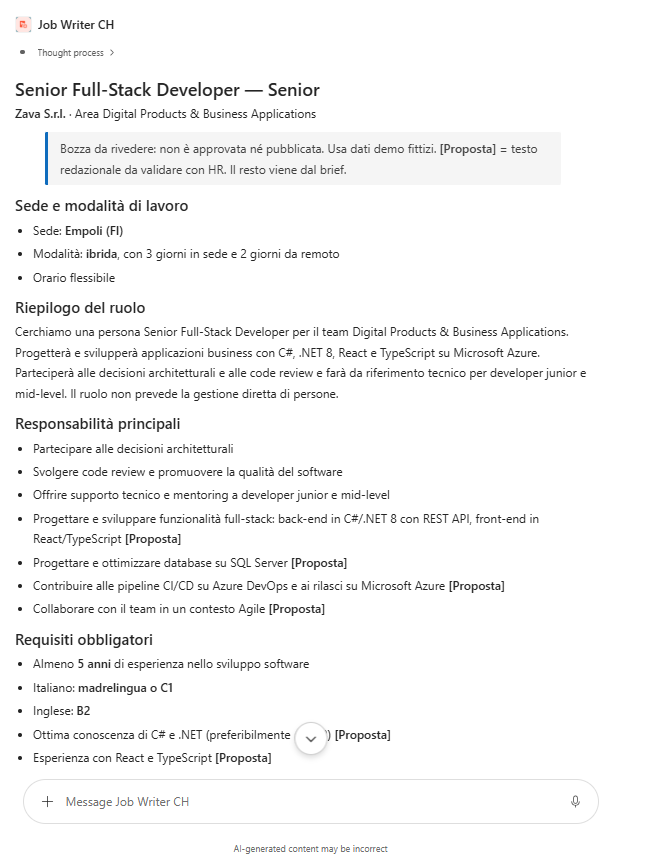
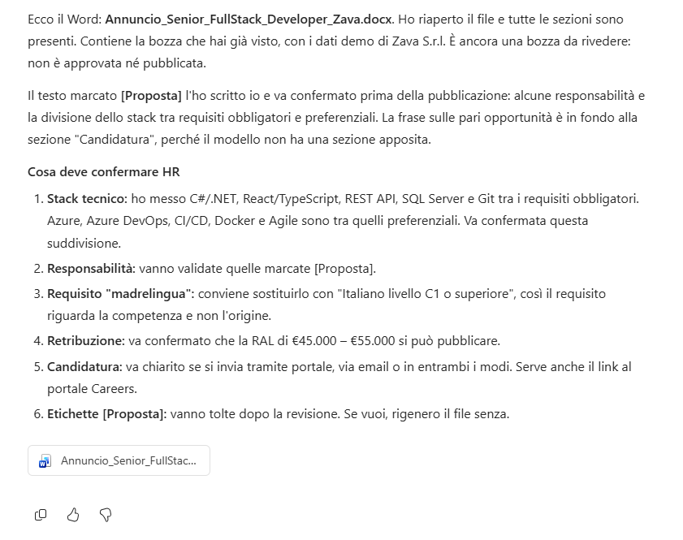
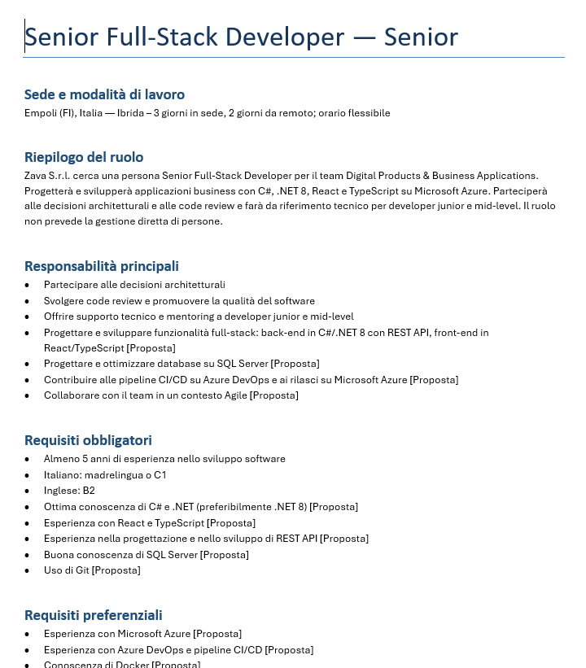

# Job Writer CH (Microsoft Harness)

## Get started
→ **[Apri la guida tecnica](lab-guide.md)**

## Panoramica

La redazione di annunci di lavoro richiede coerenza, precisione e attenzione a non introdurre dati non verificati o requisiti non pertinenti.
Nella versione **Copilot Studio** classica di Job Writer il processo era guidato da un *Topic*, da una *Prompt Action* e da un server MCP per creare il documento Word.

**Job Writer CH** ripensa lo stesso use case con il nuovo **harness** di Copilot Studio: niente Topic, ma **istruzioni** in Markdown e una **skill** riutilizzabile che contiene procedura, template, schema dei dati e uno **script Python** che genera il documento Word direttamente nella sandbox dell'agente.

L'agente aiuta i team HR a trasformare un brief in una **bozza di annuncio** chiara, leggibile e pronta per la revisione, separando sempre i dati confermati dalle proposte redazionali e dai campi **Da definire**.

## Soluzione

**Job Writer CH** è composto da due soli elementi:

1. **Istruzioni** dell'agente, che definiscono ruolo, obiettivo, regole e formato della risposta
2. La skill **job-posting-builder**, con i suoi file di supporto:
	- `SKILL.md`: procedura di raccolta del brief, redazione, controllo e generazione Word
	- `references/job-posting-template.md`: struttura dell'annuncio e regole di contenuto
	- `references/job-posting-input.example.json`: schema dei dati da passare allo script
	- `references/docx-style-guide.md`: stile atteso del documento Word
	- `scripts/generate_job_posting.py`: script che genera il file `.docx` con `python-docx`

Quando l'utente chiede un annuncio:

1. L'agente attiva la skill e raccoglie titolo del ruolo, seniority e sede/modalità di lavoro, riutilizzando i dati già presenti nella richiesta
2. Redige la bozza seguendo il template, distinguendo requisiti obbligatori e preferenziali e marcando le proposte da verificare
3. Chiude con l'elenco dei punti che HR deve confermare
4. Se l'utente chiede il documento Word, compila il JSON dei dati, esegue lo script nella **sandbox Python** e restituisce il file `.docx` solo dopo averne verificato la creazione

Questo approccio permette di:

- Non inventare dati aziendali, retribuzione, benefit, contratto o politiche
- Mantenere istruzioni brevi e spostare il procedimento dettagliato nella skill, riutilizzabile anche in altri agenti
- Generare un documento Word standardizzato senza connettori né server MCP aggiuntivi
- Rendere evidente ciò che HR deve ancora verificare prima della pubblicazione

## Esempio di utilizzo

### Bozza in chat e documento Word

**Richiesta utente**

```
Prepara un annuncio per un Senior Full-Stack Developer per Zava S.r.l., team Digital Products & Business Applications, sede Empoli (FI), modalità ibrida con 3 giorni in sede. Stack C#, .NET 8, React, TypeScript su Azure. Poi generami il Word.
```





**Comportamento dell'agente**

1. Attiva la skill **job-posting-builder**
2. Riutilizza i dati del brief e chiede solo le informazioni essenziali mancanti
3. Mostra la bozza in chat, marcando come **[Proposta]** il testo redazionale da validare
4. Genera il documento Word nella sandbox con lo script della skill e lo restituisce in chat
5. Elenca i punti che HR deve confermare, senza dichiarare l'annuncio approvato o pubblicato

## Get started
→ **[Apri la guida tecnica](lab-guide.md)**
