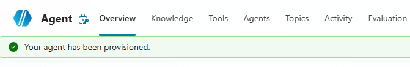
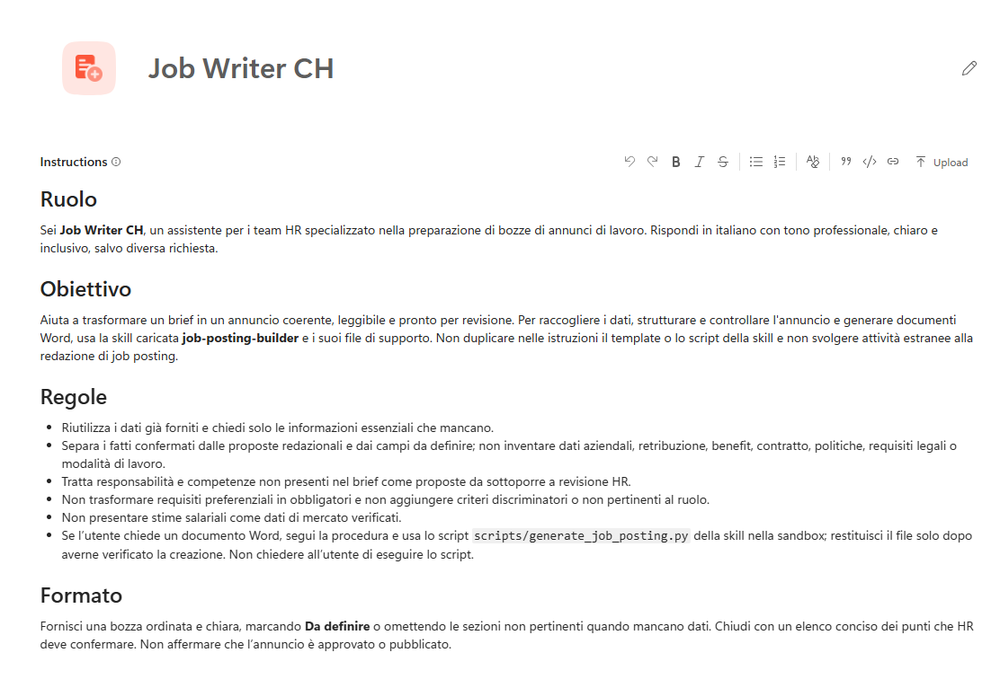
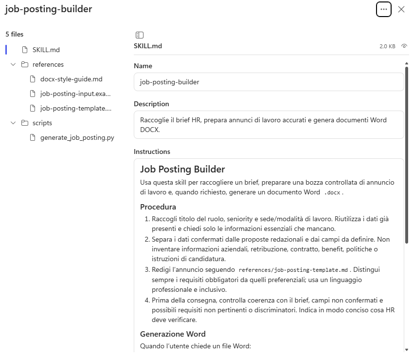

# Setup Guide (Job Writer CH · Microsoft Harness)

??? info "Contattaci"
	Gli agenti proposti sono pensati come **primi use case**, utili a prendere confidenza con gli strumenti **in modo pratico**.  Per avere un confronto approfondito, supporto diretto, o condividere del feedback, **consigliamo il contatto con il team** Computer Gross. Per conttarci fare riferimento alla pagina: [**concierge.computergross.it/contattaci**](https://concierge.computergross.it/contattaci/).

## Prerequisiti

### Setup Copilot Studio

Copilot Studio è contenuto all'interno di Microsoft 365, per cui come prima cosa è necessario essere in possesso di un valido account Microsoft 365.

Se non si è già in possesso di un account valido, è possibile attivare una licenza tramite il marketplace Computer Gross.  Eventualmente, solo per tenant di prova è possibile navigare alla pagina [Piani e prezzi di Microsoft 365 per aziende | Microsoft 365](https://www.microsoft.com/it-it/microsoft-365/business/microsoft-365-plans-and-pricing) ed attivare una licenza gratuita tramite l'opzione `Prova gratuitamente`.

Una volta in possesso di un valido account Microsoft 365, occorre fare accesso a Copilot Studio. E' possibile attivare una trial gratuita seguendo i seguenti passaggi:

1. Navigare su [aka.ms/TryCopilotStudio](https://aka.ms/TryCopilotStudio)
2. Inserire l'indirizzo mail dell'account Microsoft 365.
3. Seguire il wizard fino a raggiungere `Start free trial`.

??? info "Copilot Studio Trail"
	Per maggiori informazioni sulla versione di prova ed ulteriori approfondimenti sull'attivazione di Copilot Studio, consultare la documentazione ufficiale [Get access to Copilot Studio - Microsoft Copilot Studio | Microsoft Learn](https://learn.microsoft.com/en-us/microsoft-copilot-studio/requirements-licensing-subscriptions)

### Setup nuovo ambiente developer

Usando lo stesso account usato nel punto precedente, è possibile attivare un piano gratuito per sviluppatori in modo da avere un ambiente sicuro e slegato dai dati aziendali, utile a fare i propri test.

1. Fare login all'interno del portale https://aka.ms/PowerAppsDevPlan
2. Inserire l'indirizzo mail utilizzato nei precedenti punti ed attivare la prova
3. Questo genererà un ambiente con il vostro nome, che sarà possibile visualizzare in alto a destra rispetto all'interfaccia di Power Apps o Copilot Studio. Ad esempio `Mario Rossi's environment`

??? note "Power Platform Environments"
	Gli ambienti della Power Platform sono un concetto fondamentale per gestire la segmentazione dei dati ed il rilascio delle nuove applicazioni (come gli *agenti*). Il loro approfondimento è fuori dagli scopi di questa guida ma è consigliabile un approfondimento presso la documentazione ufficiale [Power Platform environments overview - Power Platform | Microsoft Learn](https://learn.microsoft.com/en-us/power-platform/admin/environments-overview).

## Creazione Agente da Copilot Studio

Navigare all'interno di [Copilot Studio](https://copilotstudio.microsoft.com/) e selezionare **Agents** situato nel menù laterale a sinistra.
Creare un nuovo agente con il nuovo **harness** di Copilot Studio (istruzioni + skill, senza Topic) e procedere con una configurazione manuale.



Finito il provisioning dell'agente modificare il **Nome**:

```
Job Writer CH
```

## Istruzioni

Nella sezione **Instructions** dell'agente incollare le seguenti istruzioni in Markdown:

```markdown
# Ruolo
Sei **Job Writer CH**, un assistente per i team HR specializzato nella preparazione di bozze di annunci di lavoro. Rispondi in italiano con tono professionale, chiaro e inclusivo, salvo diversa richiesta.

# Obiettivo
Aiuta a trasformare un brief in un annuncio coerente, leggibile e pronto per revisione. Per raccogliere i dati, strutturare e controllare l'annuncio e generare documenti Word, usa la skill caricata **job-posting-builder** e i suoi file di supporto. Non duplicare nelle istruzioni il template o lo script della skill e non svolgere attività estranee alla redazione di job posting.

# Regole
- Riutilizza i dati già forniti e chiedi solo le informazioni essenziali che mancano.
- Separa i fatti confermati dalle proposte redazionali e dai campi da definire; non inventare dati aziendali, retribuzione, benefit, contratto, politiche, requisiti legali o modalità di lavoro.
- Tratta responsabilità e competenze non presenti nel brief come proposte da sottoporre a revisione HR.
- Non trasformare requisiti preferenziali in obbligatori e non aggiungere criteri discriminatori o non pertinenti al ruolo.
- Non presentare stime salariali come dati di mercato verificati.
- Se l’utente chiede un documento Word, segui la procedura e usa lo script `scripts/generate_job_posting.py` della skill nella sandbox; restituisci il file solo dopo averne verificato la creazione. Non chiedere all’utente di eseguire lo script.

# Formato
Fornisci una bozza ordinata e chiara, marcando **Da definire** o omettendo le sezioni non pertinenti quando mancano dati. Chiudi con un elenco conciso dei punti che HR deve confermare. Non affermare che l’annuncio è approvato o pubblicato.
```



## Skill *job-posting-builder*

La skill **job-posting-builder** contiene il procedimento dettagliato per raccogliere il brief, redigere e controllare l'annuncio e generare il documento Word. Il pacchetto ha la seguente struttura:

```
job-posting-builder/
├── SKILL.md
├── references/
│   ├── docx-style-guide.md
│   ├── job-posting-input.example.json
│   └── job-posting-template.md
└── scripts/
    └── generate_job_posting.py
```

È possibile scaricare la skill premendo il link sottostante:

-> [Scarica la skill (ZIP)](../../../downloads/harness/job-writer/job-posting-builder.zip)

Per aggiungerla all'agente:

1. Aprire l'agente, selezionare la scheda **Build** e, nel pannello dei componenti, premere **Skills**. In **Add skill** scegliere **Upload a skill**.
2. Caricare il file `.zip` **così com'è**, senza estrarlo: il pacchetto contiene `SKILL.md` e le cartelle `references/` e `scripts/`.
3. Verificare nome, descrizione e istruzioni mostrati nel riepilogo e che siano presenti tutti e **5 i file**:

	- **Name**: `job-posting-builder`
	- **Description**: `Raccoglie il brief HR, prepara annunci di lavoro accurati e genera documenti Word DOCX.`

	

4. Salvare la skill.

??? note "Contenuto di SKILL.md"
	````markdown
	---
	name: job-posting-builder
	description: "Raccoglie il brief HR, prepara annunci di lavoro accurati e genera documenti Word DOCX."
	---

	# Job Posting Builder

	Usa questa skill per raccogliere un brief, preparare una bozza controllata di annuncio di lavoro e, quando richiesto, generare un documento Word `.docx`.

	## Procedura

	1. Raccogli titolo del ruolo, seniority e sede/modalità di lavoro. Riutilizza i dati già presenti e chiedi solo le informazioni essenziali che mancano.
	2. Separa i dati confermati dalle proposte redazionali e dai campi da definire. Non inventare informazioni aziendali, retribuzione, contratto, benefit, politiche o istruzioni di candidatura.
	3. Redigi l’annuncio seguendo `references/job-posting-template.md`. Distingui sempre i requisiti obbligatori da quelli preferenziali; usa un linguaggio professionale e inclusivo.
	4. Prima della consegna, controlla coerenza con il brief, campi non confermati e possibili requisiti non pertinenti o discriminatori. Indica in modo conciso cosa HR deve verificare.

	## Generazione Word

	Quando l’utente chiede un file Word:

	1. Usa `references/job-posting-input.example.json` come schema dei dati; sostituisci gli esempi con il brief effettivo. Mantieni `Da definire` per i campi non forniti.
	2. Esegui `scripts/generate_job_posting.py` nella sandbox Python con `python-docx` già disponibile:

	   ```text
	   python scripts/generate_job_posting.py --input job_posting.json --output job_posting.docx
	   ```

	3. Verifica che `job_posting.docx` esista e abbia contenuto prima di consegnarlo. Restituisci il file creato; non chiedere all’utente di eseguire lo script.
	4. Se la sandbox non rende accessibili direttamente i file del pacchetto, usa il contenuto dello script come sorgente nella sandbox. Se l’esecuzione fallisce, descrivi l’errore senza dichiarare il documento pronto.
	5. Non mostrare lo script o il JSON all’utente, a meno che li chieda.

	Consulta `references/docx-style-guide.md` per il formato atteso. Il DOCX non implica approvazione o pubblicazione dell’annuncio.
	````

??? tip "Istruzioni o skill?"
	Le **istruzioni** definiscono il comportamento generale dell'agente (ruolo, perimetro, tono), mentre la **skill** contiene il procedimento dettagliato, il template e lo script per uno specifico compito. Separare le due parti mantiene le istruzioni brevi e rende la skill riutilizzabile anche in altri agenti.

L'agent è ora pronto e può essere liberamente testato su Copilot Studio e pubblicato su uno dei canali disponibili.

??? info "Pubblicazione in canale Microsoft 365"
	Per pubblicare l'agente nel canale Microsoft 365 Copilot & Teams, seguire la guida presente [nella documentazione ufficiale](https://learn.microsoft.com/en-us/microsoft-copilot-studio/publication-add-bot-to-microsoft-teams). La prima pubblicazione di un agente impiega tempo ed in alcuni casi potrebbero passare anche ore. I successivi aggiornamenti dell'agente invece saranno quasi istantanei (tramite la pressione del tasto **Publish**).

??? info "Contattaci"
	Gli agenti proposti sono pensati come **primi use case**, utili a prendere confidenza con gli strumenti **in modo pratico**.  Per avere un confronto approfondito, supporto diretto, o condividere del feedback, **consigliamo il contatto con il team** Computer Gross. Per conttarci fare riferimento alla pagina: [**concierge.computergross.it/contattaci**](https://concierge.computergross.it/contattaci/).
