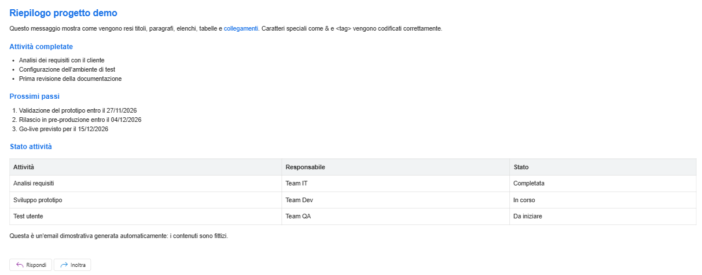

# Postman CH (Microsoft Harness)

## Get started
→ **[Apri la guida tecnica](lab-guide.md)**

## Panoramica

Nel lavoro quotidiano, molte conversazioni avvengono in chat e portano a una risposta finale chiara e consolidata, che deve essere condivisa via email in modo formale e tracciabile.

Con **Postman (v2)** la risposta finale veniva trasformata in HTML da un prompt e inviata tramite un connettore Outlook, con l’agente configurato come **Connected Agent** all’interno di una catena multi-agente.

**Postman CH (Microsoft Harness)** riprende lo stesso obiettivo usando il nuovo harness di Copilot Studio: il comportamento dell’agente è descritto da **istruzioni in markdown**, la generazione del corpo email è affidata a una **skill** che esegue uno script Python in sandbox e l’invio è gestito da un **tool** basato sul connettore Office 365 Outlook.

Rispetto alla versione classica, l’agente diventa più prudente e deterministico:

- Invia un’email **solo su richiesta esplicita** dell’utente (o quando l’agente chiamante la trasmette chiaramente)
- Usa **solo il destinatario confermato** dall’utente o esplicitamente disponibile nel contesto, senza dedurre indirizzi
- Genera l’HTML tramite uno **script** che codifica il testo e convalida i link, invece di lasciare al modello la scrittura di HTML grezzo

## Soluzione

**Postman CH** seleziona la risposta finale dell’assistente più pertinente alla richiesta e la inoltra via email **senza riassumerla né modificarla**.

L’agente si basa su due componenti con responsabilità separate:

1. **Skill Postman Email Recap**
	- Rappresenta la risposta selezionata come **JSON strutturato** (titoli, paragrafi, elenchi, tabelle, citazioni e link)
	- Esegue lo script `render_email_body.py` nella **sandbox Python**, che applica il template HTML con stili inline compatibili con i client email
	- Esegue l’escape del testo e accetta solo link `http`, `https` o `mailto`

2. **Send Email Recap**
	- Invia **una sola email** al destinatario confermato
	- Compila l’oggetto con un riassunto sintetico (massimo 8 parole)
	- Inserisce nel corpo **esattamente** il frammento HTML generato dalla skill

Questo approccio permette di:

- Eliminare qualsiasi selezione o copia manuale del contenuto
- Garantire che la risposta finale venga riportata integralmente e senza alterazioni
- Ottenere un HTML email-safe coerente e ripetibile, generato da codice invece che dal modello
- Evitare invii proattivi, destinatari inventati, allegati o destinatari in CC/BCC
- Usare l’agente sia direttamente sia come **agente connesso** di un altro agente

## Esempio di utilizzo

### Invio del riepilogo via email

L’utente ottiene una risposta articolata (ad esempio il riepilogo di un progetto) e chiede di riceverla via email.

**Richiesta utente**

`Inviami questa risposta via mail`

**Comportamento dell’agente**

1. Verifica che l’utente abbia chiesto esplicitamente l’invio
2. Seleziona la risposta finale dell’assistente pertinente alla richiesta, chiedendo chiarimenti se è ambigua
3. Usa la skill **Postman Email Recap** per generare il frammento HTML nella sandbox
4. Chiede il destinatario se non è esplicitamente disponibile nel contesto
5. Invia l’email tramite **Send Email Recap** con un oggetto di massimo 8 parole
6. Conferma brevemente il destinatario, senza riprodurre lo storico della conversazione

Il risultato è un’email in cui titoli, elenchi, tabelle e link della risposta originale vengono resi con uno stile uniforme:

## Get started
→ **[Apri la guida tecnica](lab-guide.md)**
