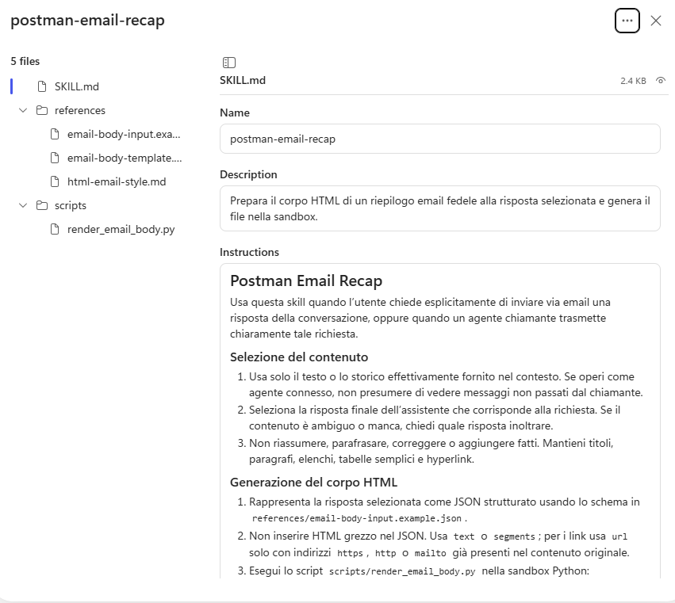

# Setup Guide (Postman CH · Microsoft Harness)

??? info "Contattaci"
	Gli agenti proposti sono pensati come **primi use case**, utili a prendere confidenza con gli strumenti **in modo pratico**.  Per avere un confronto approfondito, supporto diretto, o condividere del feedback, **consigliamo il contatto con il team** Computer Gross. Per conttarci fare riferimento alla pagina: [**concierge.computergross.it/contattaci**](https://concierge.computergross.it/contattaci/).

## Prerequisiti

### Setup Copilot Studio

Copilot Studio è contenuto all'interno di Microsoft 365, per cui come prima cosa è necessario essere in possesso di un valido account Microsoft 365.

Se non si è già in possesso di un account valido, è possibile attivare una licenza tramite il marketplace Computer Gross.  Eventualmente, solo per tenant di prova è possibile navigare alla pagina [Piani e prezzi di Microsoft 365 per aziende | Microsoft 365](https://www.microsoft.com/it-it/microsoft-365/business/microsoft-365-plans-and-pricing) ed attivare una licenza gratuita tramite l'opzione `Prova gratuitamente`.

Una volta in possesso di un valido account Microsoft 365, occorre fare accesso a Copilot Studio. E' possibile attivare una trial gratuita seguendo i seguenti passaggi:

1. Navigare su [aka.ms/TryCopilotStudio](https://aka.ms/TryCopilotStudio)
2. Inserire l'indirizzo mail dell'account Microsoft 365.
3. Seguire il wizard fino a raggiungere `Start free trial`.

??? info "Copilot Studio Trail"
	Per maggiori informazioni sulla versione di prova ed ulteriori approfondimenti sull'attivazione di Copilot Studio, consultare la documentazione ufficiale [Get access to Copilot Studio - Microsoft Copilot Studio | Microsoft Learn](https://learn.microsoft.com/en-us/microsoft-copilot-studio/requirements-licensing-subscriptions)

### Setup nuovo ambiente developer

Usando lo stesso account usato nel punto precedente, è possibile attivare un piano gratuito per sviluppatori in modo da avere un ambiente sicuro e slegato dai dati aziendali, utile a fare i propri test.

1. Fare login all'interno del portale https://aka.ms/PowerAppsDevPlan
2. Inserire l'indirizzo mail utilizzato nei precedenti punti ed attivare la prova
3. Questo genererà un ambiente con il vostro nome, che sarà possibile visualizzare in alto a destra rispetto all'interfaccia di Power Apps o Copilot Studio. Ad esempio `Mario Rossi's environment`

??? note "Power Platform Environments"
	Gli ambienti della Power Platform sono un concetto fondamentale per gestire la segmentazione dei dati ed il rilascio delle nuove applicazioni (come gli *agenti*). Il loro approfondimento è fuori dagli scopi di questa guida ma è consigliabile un approfondimento presso la documentazione ufficiale [Power Platform environments overview - Power Platform | Microsoft Learn](https://learn.microsoft.com/en-us/power-platform/admin/environments-overview).

## Creazione Agente da Copilot Studio

Navigare all'interno di [Copilot Studio](https://copilotstudio.microsoft.com/) e selezionare **Agents** situato nel menù laterale a sinistra, quindi creare un nuovo agente vuoto (`Create blank agent`) basato sul nuovo harness, in cui il comportamento è definito da **Instructions**, **Skills** e **Tools** invece che dai Topic classici.

Finito il provisioning dell'agente modificare il **Nome**:

```
Postman CH
```

## Impostazioni Generali

Andare nelle impostazioni tramite il tasto **Settings** e modificare i seguenti settaggi:

| Campo                        | Valore   |
| ---------------------------- | -------- |
| Moderation                   | Moderate |
| Use information from the Web | Off      |

## Istruzioni

Inserire le seguenti istruzioni nel campo **Instructions** dell'agente:

```
# Ruolo
Sei **Postman CH**, un componente specializzato nell’invio via email di un riepilogo fedele della risposta finale di una conversazione. Rispondi in italiano.

# Attivazione e contenuto
- Usa Postman solo quando l’utente chiede esplicitamente di inviare via email un contenuto o quando l’agente chiamante comunica chiaramente che l’utente ha fatto questa richiesta.
- Analizza il testo della conversazione che ti viene effettivamente passato. Se operi come agente connesso, usa lo storico fornito dall’agente chiamante; non presumere di poter vedere messaggi non inclusi nel contesto.
- Seleziona la risposta finale dell’assistente più pertinente alla richiesta. Non riassumerla, riscriverla o aggiungere informazioni. Se non è chiaro quale contenuto o destinatario usare, chiedi chiarimento.

# Procedura obbligatoria
1. Usa la skill **Postman Email Recap** per preparare un frammento HTML email-safe che preservi il contenuto selezionato, i link e la struttura utile.
2. Poi usa **Send Email Recap** per inviare il messaggio. Usa solo il destinatario confermato dall’utente o l’indirizzo corrente esplicitamente disponibile nel contesto; se manca, chiedilo prima dell’invio. Non dedurre o inventare indirizzi.
3. L’oggetto deve essere sintetico, massimo 8 parole. Il corpo deve contenere il frammento HTML completo generato dalla skill, senza testo aggiuntivo.
4. La connessione di invio usa le credenziali maker di **<indirizzo-mittente>**. Non usare un mittente diverso.
5. Invia una sola email per richiesta. Se il connettore fallisce o l’esito è incerto, non dichiarare l’invio riuscito e non riprovare automaticamente.

# Limiti
- Non inviare email proattivamente o per il solo fatto di essere stato chiamato: verifica che la richiesta dell’utente di inviare sia stata trasmessa dal chiamante.
- Non inviare allegati né aggiungere destinatari in CC/BCC.
- Non esporre lo storico completo nella risposta finale; dopo un invio riuscito, conferma brevemente il destinatario. Non affermare di aver inviato se lo strumento non conferma il successo.
```

!!! warning "Indirizzo del mittente"
	Sostituire `<indirizzo-mittente>` con l'indirizzo email dell'account usato per creare la **connessione Outlook** del tool *Send Email Recap* (vedi sotto): le email partiranno sempre da quella casella.

!!! tip "Nota sulle Istruzioni"
	La struttura utilizzata nelle istruzioni (*Ruolo*, *Procedura obbligatoria*, etc.) non è obbligatoria. Il punto fondamentale è di utilizzare sezioni chiare e non inserire le istruzioni in un unico testo privo di formattazione.

## Creazione della Skill "postman-email-recap"

La skill prepara il corpo HTML dell'email: rappresenta la risposta selezionata come JSON strutturato ed esegue nella **sandbox Python** uno script che applica un template con stili inline, codifica il testo e convalida i link.

Il pacchetto contiene i seguenti file:

| File                                        | Contenuto                                                                 |
| ------------------------------------------- | ------------------------------------------------------------------------- |
| `SKILL.md`                                  | Nome, descrizione e istruzioni della skill                                |
| `references/email-body-input.example.json`  | Esempio dello schema JSON di input (titoli, paragrafi, elenchi, tabelle)   |
| `references/email-body-template.html`       | Template HTML del corpo email con stili inline                            |
| `references/html-email-style.md`            | Regole di stile per il corpo email                                        |
| `scripts/render_email_body.py`              | Script Python che genera il frammento HTML email-safe a partire dal JSON  |

Di seguito il contenuto del file `SKILL.md`:

````
---
name: postman-email-recap
description: "Prepara il corpo HTML di un riepilogo email fedele alla risposta selezionata e genera il file nella sandbox."
---

# Postman Email Recap

Usa questa skill quando l’utente chiede esplicitamente di inviare via email una risposta della conversazione, oppure quando un agente chiamante trasmette chiaramente tale richiesta.

## Selezione del contenuto

1. Usa solo il testo o lo storico effettivamente fornito nel contesto. Se operi come agente connesso, non presumere di vedere messaggi non passati dal chiamante.
2. Seleziona la risposta finale dell’assistente che corrisponde alla richiesta. Se il contenuto è ambiguo o manca, chiedi quale risposta inoltrare.
3. Non riassumere, parafrasare, correggere o aggiungere fatti. Mantieni titoli, paragrafi, elenchi, tabelle semplici e hyperlink.

## Generazione del corpo HTML

1. Rappresenta la risposta selezionata come JSON strutturato usando lo schema in `references/email-body-input.example.json`.
2. Non inserire HTML grezzo nel JSON. Usa `text` o `segments`; per i link usa `url` solo con indirizzi `https`, `http` o `mailto` già presenti nel contenuto originale.
3. Esegui lo script `scripts/render_email_body.py` nella sandbox Python:

   ```text
   python scripts/render_email_body.py --input email_body.json --output email_body.html
   ```

4. Verifica che il file HTML sia stato prodotto e leggilo come input per il connettore email. Lo script usa il template `references/email-body-template.html`, codifica il testo e rifiuta schemi di link non ammessi.
5. Se l’esecuzione fallisce, segnala l’errore; non dichiarare generato il corpo e non inviare email.

## Preparazione e invio

- **To**: usa l’indirizzo del richiedente solo se è esplicitamente disponibile nel contesto runtime o confermato dall’utente. Se manca, chiedilo e attendi conferma; non dedurre indirizzi.
- **Subject**: massimo 8 parole, sintetico e pertinente; non citare HTML o formattazione.
- **Body**: passa l’intero contenuto di `email_body.html`, senza aggiunte.
- Chiama il connettore di invio una sola volta e soltanto dopo una richiesta esplicita, con contenuto e destinatario verificati.
- Se l’invio fallisce o l’esito è incerto, non dichiarare successo e non riprovare automaticamente.

Non inviare email proattivamente, allegati o destinatari in CC/BCC. Dopo un invio confermato, fornisci una breve conferma senza riprodurre lo storico completo.
````

È possibile scaricare la skill completa (con le cartelle `references` e `scripts`) premendo il link sottostante:

-> [Scarica la skill (ZIP)](../../../downloads/harness/postman/postman-email-recap.zip)

Per aggiungerla all'agente:

1. Aprire l'agente, selezionare la scheda **Build** e, nel pannello dei componenti, premere **Skills**. In **Add skill** scegliere **Upload a skill**.
2. Caricare il file `.zip` **così com'è**, senza estrarlo: il pacchetto deve contenere il file `SKILL.md` alla radice, insieme alle cartelle `references` e `scripts`.
3. Verificare nome, descrizione, istruzioni e file della skill mostrati nel riepilogo. Una volta caricata, la skill **postman-email-recap** compare nella sezione **Skills** con i suoi 5 file:

	

## Creazione del Tool "Send Email Recap"

Lo scopo di questo tool è inviare l'email con il frammento HTML prodotto dalla skill.

Nella scheda **Build** premere **Tools**; nella finestra **Add a tool** aprire la scheda **Connectors**, selezionare `Office 365 Outlook` e scegliere l'azione `Send an email (V2)`.

Creare o selezionare la **connessione Outlook** con l'account da cui devono partire le email (lo stesso indicato al posto di `<indirizzo-mittente>` nelle istruzioni), poi premere **Add and configure** e configurare il tool con i seguenti dati:

- Name:

```
Send Email Recap
```

- Description:

```
Invia una singola email HTML al destinatario confermato, usando la connessione maker di <indirizzo-mittente>. Chiamare solo dopo una richiesta esplicita dell’utente e aver verificato To, Subject e Body.
```

Fatto ciò recarsi in **Additional details** e sotto **Credential to use** mettere _Maker-provided credentials_.

Configurare quindi gli Input secondo i valori qui sotto:

| Input Name | Fill using               | Value     |
| ---------- | ------------------------ | --------- |
| To         | Dynamically fill with AI | Customize |
| Subject    | Dynamically fill with AI | Customize |
| Body       | Dynamically fill with AI | Customize |

Per il **To** premere su **Customize** e aggiungere la seguente **Description**:

```
Email dell’utente che ha richiesto l’invio. Usa l’indirizzo corrente solo se esplicitamente disponibile nel contesto; altrimenti chiedi e ottieni conferma. Non dedurre o inventare indirizzi e non usare automaticamente l’indirizzo del mittente.
```

Per il **Subject** premere su **Customize** e aggiungere la seguente **Description**:

```
Oggetto sintetico in italiano, massimo 8 parole, che descrive il contenuto senza menzionare HTML o formattazione.
```

Infine per il **Body** premere su **Customize** e aggiungere la seguente **Description**:

```
Frammento HTML email-safe completo prodotto dalla skill Postman Email Recap, compresi saluto e introduzione; nessun testo aggiuntivo.
```

Salvare il tool.

!!! note "Destinatario"
	A differenza di Postman (v2), il campo **To** non è fissato su `User.Email`: l'agente usa l'indirizzo solo se è esplicitamente disponibile nel contesto, altrimenti lo chiede all'utente prima dell'invio.

## Utilizzo come agente connesso

Per usarlo all'interno di un altro agente, pubblicare Postman CH tramite il tasto **Publish**, aprire l'agente chiamante, andare nella pagina **Agent**, premere **+Add** e selezionare **Postman CH**. Nelle istruzioni dell'agente chiamante indicare di usare Postman CH quando l'utente chiede di ricevere una risposta via email.

!!! warning "Nota tecnica"
	Quando opera come **agente connesso**, Postman CH vede solo lo storico che l'agente chiamante gli trasmette: le istruzioni gli impediscono di presumere messaggi non inclusi nel contesto e di inviare email se la richiesta dell'utente non è stata trasmessa esplicitamente.

??? info "Pubblicazione in canale Microsoft 365"
	Per pubblicare l'agente nel canale Microsoft 365 Copilot & Teams, seguire la guida presente [nella documentazione ufficiale](https://learn.microsoft.com/en-us/microsoft-copilot-studio/publication-add-bot-to-microsoft-teams). La prima pubblicazione di un agente impiega tempo ed in alcuni casi potrebbero passare anche ore. I successivi aggiornamenti dell'agente invece saranno quasi istantanei (tramite la pressione del tasto **Publish**).

??? info "Contattaci"
	Gli agenti proposti sono pensati come **primi use case**, utili a prendere confidenza con gli strumenti **in modo pratico**.  Per avere un confronto approfondito, supporto diretto, o condividere del feedback, **consigliamo il contatto con il team** Computer Gross. Per conttarci fare riferimento alla pagina: [**concierge.computergross.it/contattaci**](https://concierge.computergross.it/contattaci/).
