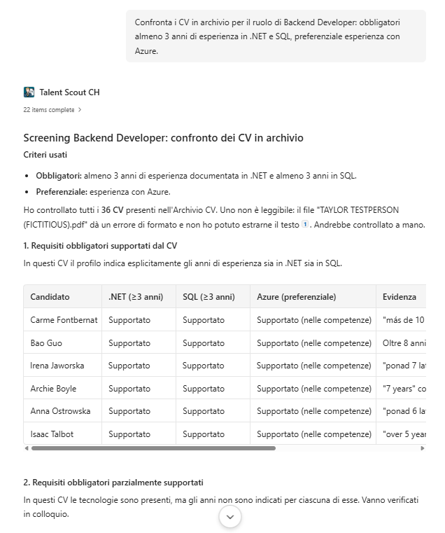
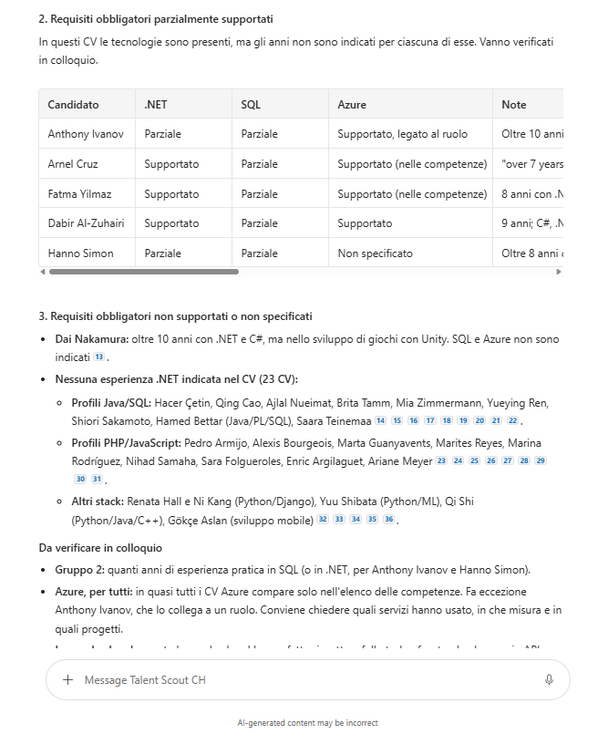
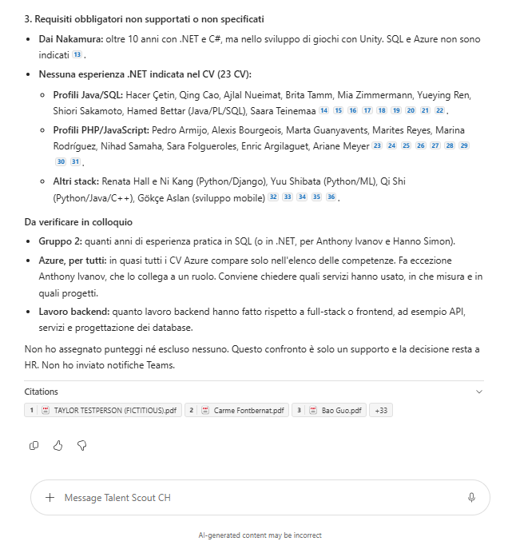

# Talent Scout CH (Microsoft Harness)

## Get started

→ **[Apri la guida tecnica](lab-guide.md)**

## Panoramica

La selezione dei candidati richiede tempo, metodo e capacità di analisi.  
Con un approccio tradizionale, i CV arrivano via email, vengono salvati manualmente e analizzati uno a uno, con un elevato dispendio di tempo, criteri non sempre uniformi e rischio di perdita di informazioni.

**Talent Scout (v2)** aveva già introdotto la ricerca conversazionale sull'archivio CV e un trigger email che salva le candidature su SharePoint e avvisa il team su Teams, modellando il comportamento con istruzioni e tool classici.

**Talent Scout CH** ripensa lo stesso use case con il nuovo **harness** di Copilot Studio. Il comportamento dell'agente non è più distribuito tra istruzioni lunghe e Topic, ma è descritto da:

- **Istruzioni** in Markdown che definiscono ruolo, fonti, regole di equità e privacy;
- due **Skill** testuali: *CV Screening* per il confronto tra CV e criteri, *Applicant Teams Notification* per la notifica al canale Teams;
- un **Workflow** (*Notify Teams Applicant channel*) che pubblica una Adaptive Card nel canale Applicant;
- una **Knowledge** SharePoint (*Archivio CV*) che contiene i CV.

Il risultato è uno screening **più trasparente, coerente e verificabile**: ogni candidato viene confrontato con gli stessi criteri, con evidenze esplicite e lacune dichiarate, lasciando sempre a HR la decisione finale.

## Soluzione

**Talent Scout CH** separa chiaramente la parte conversazionale (screening) dalla parte di automazione (raccolta CV e notifica).

Quando HR chiede un confronto tra candidati:

1. L'agente applica la skill **CV Screening** e identifica ruolo, requisiti obbligatori e preferenziali; se mancano criteri essenziali chiede un chiarimento
2. Cerca le evidenze nei CV della knowledge **Archivio CV**
3. Costruisce per ogni candidato una matrice sintetica requisito / evidenza / stato (`supportato`, `parzialmente supportato`, `non specificato`, `non supportato`)
4. Riassume competenze pertinenti e aree da verificare in colloquio, ricordando che l'output è un supporto alla valutazione umana

Quando arriva una nuova candidatura (flusso di intake, **opzionale**):

1. Il flusso *Talent Scout - Intake CV* intercetta una email con oggetto `Application` e allegato PDF
2. Salva il CV nella libreria documenti del sito SharePoint e crea un link di sola lettura limitato all'organizzazione
3. Invoca l'agente con un prompt che contiene `ResumeLink` e `ResumeName`
4. L'agente segue la skill **Applicant Teams Notification** e chiama il workflow **Notify Teams Applicant channel**, che pubblica la card nel canale Teams

!!! note "Trigger email"
	Il trigger email viene configurato separatamente dall'utente: la guida tecnica descrive come crearlo come Agent Flow.

Questo approccio permette di:

- Applicare criteri job-related espliciti e uguali per tutti i candidati
- Rendere evidenti le informazioni mancanti invece di dedurle
- Escludere caratteristiche sensibili o protette dalla valutazione
- Inviare al team solo i dati necessari (link e nome file), mai il contenuto del CV
- Mantenere istruzioni brevi e regole operative incapsulate nelle skill

## Esempio di utilizzo

### Screening di candidati con criteri espliciti

**Richiesta utente**

```
Confronta i CV in archivio per il ruolo di Backend Developer: obbligatori almeno 3 anni di esperienza in .NET e SQL, preferenziale esperienza con Azure.
```

**Comportamento dell'agente**

1. Riconosce ruolo, requisiti obbligatori e preferenziali
2. Cerca le evidenze nei CV di *Archivio CV*
3. Restituisce, per ogni candidato, la matrice requisito / evidenza / stato
4. Indica le aree da approfondire in colloquio e ricorda che la decisione resta a HR





### Notifica di un nuovo CV al canale Applicant

**Evento**

Il flusso di intake salva su SharePoint il file `CV_NomeCandidato.pdf` e invoca l'agente con `ResumeLink` e `ResumeName`.

**Comportamento dell'agente**

1. Verifica che siano presenti entrambi i campi
2. Chiama *Notify Teams Applicant channel* passando solo link e nome file
3. Conferma l'invio solo se il workflow restituisce `Finished`

## Get started

→ **[Apri la guida tecnica](lab-guide.md)**
