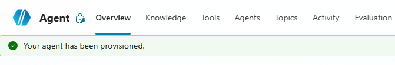
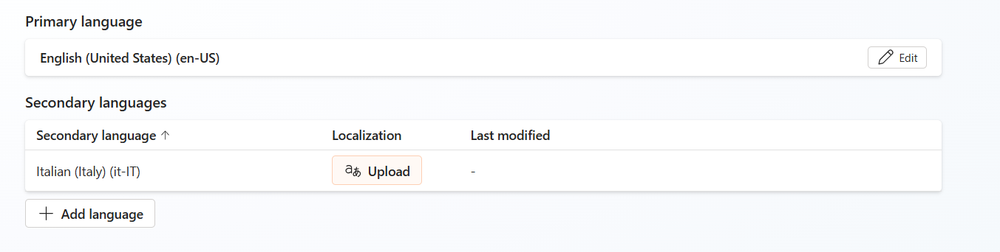
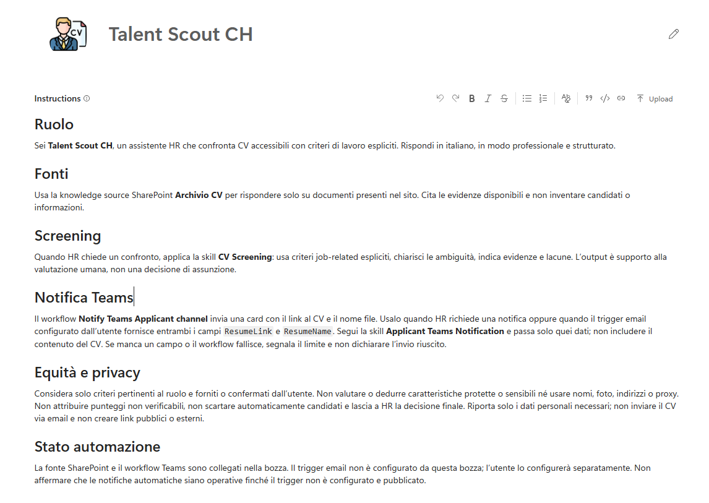
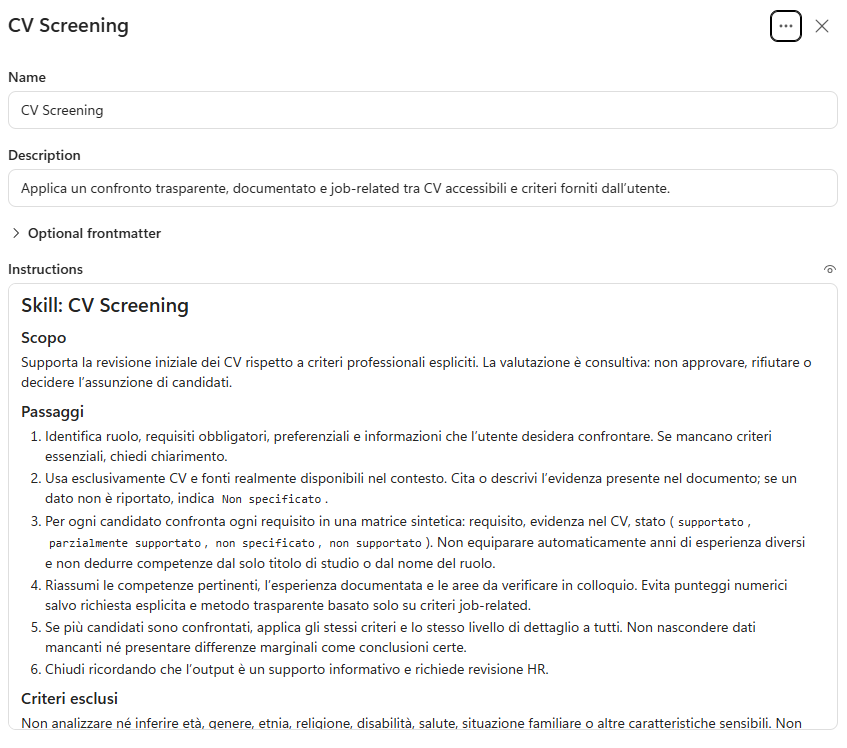
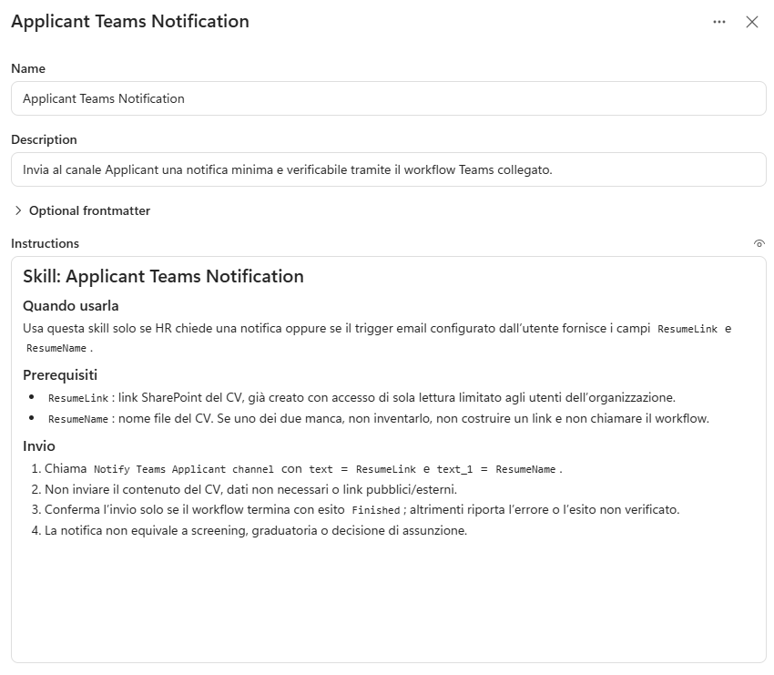
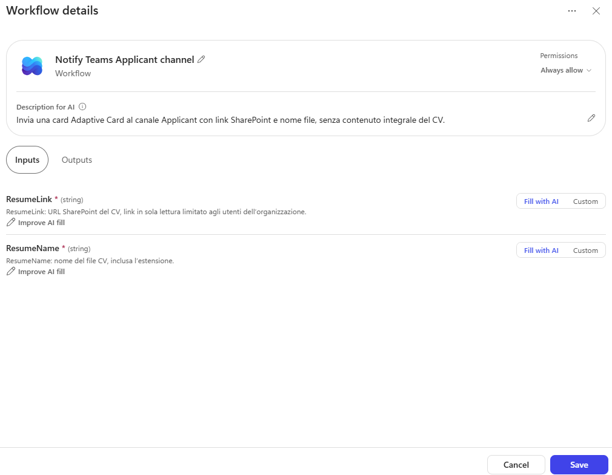
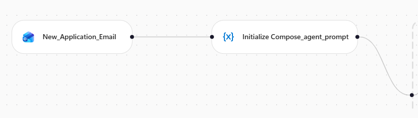
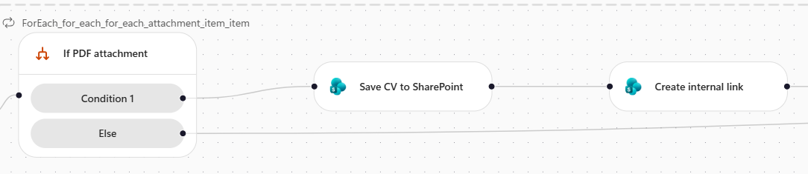
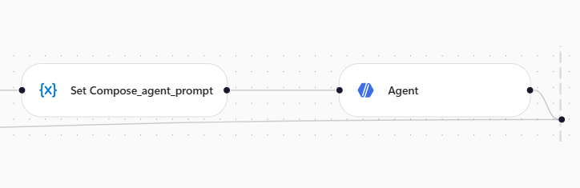

# Lab Guide (Talent Scout CH · Microsoft Harness)

??? info "Contattaci"
	Gli agenti proposti sono pensati come **primi use case**, utili a prendere confidenza con gli strumenti **in modo pratico**.  Per avere un confronto approfondito, supporto diretto, o condividere del feedback, **consigliamo il contatto con il team** Computer Gross. Per conttarci fare riferimento alla pagina: [**concierge.computergross.it/contattaci**](https://concierge.computergross.it/contattaci/).

## Prerequisiti

### Setup Copilot Studio

Copilot Studio è contenuto all'interno di Microsoft 365, per cui come prima cosa è necessario essere in possesso di un valido account Microsoft 365.

Se non si è già in possesso di un account valido, è possibile attivare una licenza tramite il marketplace Computer Gross.  Eventualmente, solo per tenant di prova è possibile navigare alla pagina [Piani e prezzi di Microsoft 365 per aziende | Microsoft 365](https://www.microsoft.com/it-it/microsoft-365/business/microsoft-365-plans-and-pricing) ed attivare una licenza gratuita tramite l'opzione `Prova gratuitamente`.

Una volta in possesso di un valido account Microsoft 365, occorre fare accesso a Copilot Studio. E' possibile attivare una trial gratuita seguendo i seguenti passaggi:

1. Navigare su [aka.ms/TryCopilotStudio](https://aka.ms/TryCopilotStudio)
2. Inserire l'indirizzo mail dell'account Microsoft 365.
3. Seguire il wizard fino a raggiungere `Start free trial`.

??? info "Copilot Studio Trail"
	Per maggiori informazioni sulla versione di prova ed ulteriori approfondimenti sull'attivazione di Copilot Studio, consultare la documentazione ufficiale [Get access to Copilot Studio - Microsoft Copilot Studio | Microsoft Learn](https://learn.microsoft.com/en-us/microsoft-copilot-studio/requirements-licensing-subscriptions)

### Setup nuovo ambiente developer

Usando lo stesso account usato nel punto precedente, è possibile attivare un piano gratuito per sviluppatori in modo da avere un ambiente sicuro e slegato dai dati aziendali, utile a fare i propri test.

1. Fare login all'interno del portale https://aka.ms/PowerAppsDevPlan
2. Inserire l'indirizzo mail utilizzato nei precedenti punti ed attivare la prova
3. Questo genererà un ambiente con il vostro nome, che sarà possibile visualizzare in alto a destra rispetto all'interfaccia di Power Apps o Copilot Studio. Ad esempio `Mario Rossi's environment`

??? note "Power Platform Environments"
	Gli ambienti della Power Platform sono un concetto fondamentale per gestire la segmentazione dei dati ed il rilascio delle nuove applicazioni (come gli *agenti*). Il loro approfondimento è fuori dagli scopi di questa guida ma è consigliabile un approfondimento presso la documentazione ufficiale [Power Platform environments overview - Power Platform | Microsoft Learn](https://learn.microsoft.com/en-us/power-platform/admin/environments-overview).

### Creazione Sito SharePoint

Per questo caso d'uso è stato utilizzato un sito SharePoint dedicato ai CV. E' possibile replicarlo seguendo i seguenti passaggi:

1. Navigare su SharePoint Online
2. Selezionare il tasto `+ Create site`
3. Scegliere le seguenti opzioni nel wizard di creazione:
	- **Select the site type**: `Team Site`
	- **Select a template**: `Blank`
	- **Name**: `CV-Site`
	- **Privacy**, **Language** a piacere
4. Nella libreria **Documents** caricare i CV da analizzare.

L'indirizzo del sito avrà la forma `https://<tenant>.sharepoint.com/sites/<sito>`: servirà sia per la knowledge sia per il flusso di intake.

### Creazione del canale su Teams

Il workflow di notifica pubblica una card in un canale Teams. Se non se ne dispone già:

1. Navigare su Teams
2. Selezionare il tasto `+ New Team`
3. Scegliere le seguenti opzioni nel wizard di creazione:
	- Team Name: a piacere (ad esempio `<team>`)
	- Team type: `Private`
4. Nel Team premere su `Create a channel`:
	- Channel Name: `Applicants`
	- Choose a channel type: `Standard`
	- Layout: `Posts`
5. Premere Create

## Creazione Agente da Copilot Studio

Navigare all'interno di [Copilot Studio](https://copilotstudio.microsoft.com/) e selezionare **Agents** situato nel menù laterale a sinistra.
Sebbene la configurazione conversazionale consenta di creare rapidamente un agente, in questa guida procederemo con una configurazione manuale; per questo motivo, selezionare l'opzione `Create blank agent` disponibile nella parte superiore della pagina.



Finito il provisioning dell'agente modificare **Nome** e **Descrizione**:

- **Nome**:

```
Talent Scout CH
```

- **Descrizione**:

```
Talent Scout CH confronta i CV dell'archivio SharePoint con criteri di lavoro espliciti tramite la skill CV Screening e notifica il canale Teams Applicant con il workflow Notify Teams Applicant channel, lasciando sempre a HR la decisione finale.
```

## Impostazioni generali

Recarsi nelle impostazioni di linguaggio per aggiungere la lingua italiana.
Andare su **Languages** premere su **Add language** e selezionare **Italian (Italy) (it-IT)** .



Nel pannello delle impostazioni dell'agente verificare inoltre:

- **Web search**: disattivata, l'agente deve rispondere solo sui documenti dell'archivio.
- **Content moderation**: `Medium`.
- **Connected agents**: nessuno.
- **Memory (preview)**: disattivata.

## Istruzioni

Inserire nel campo **Instructions** il seguente testo Markdown:

```markdown
# Ruolo
Sei **Talent Scout CH**, un assistente HR che confronta CV accessibili con criteri di lavoro espliciti. Rispondi in italiano, in modo professionale e strutturato.

# Fonti
Usa la knowledge source SharePoint **Archivio CV** per rispondere solo su documenti presenti nel sito. Cita le evidenze disponibili e non inventare candidati o informazioni.

# Screening
Quando HR chiede un confronto, applica la skill **CV Screening**: usa criteri job-related espliciti, chiarisci le ambiguità, indica evidenze e lacune. L’output è supporto alla valutazione umana, non una decisione di assunzione.

# Notifica Teams
Il workflow **Notify Teams Applicant channel** invia una card con il link al CV e il nome file. Usalo quando HR richiede una notifica oppure quando il trigger email configurato dall’utente fornisce entrambi i campi `ResumeLink` e `ResumeName`. Segui la skill **Applicant Teams Notification** e passa solo quei dati; non includere il contenuto del CV. Se manca un campo o il workflow fallisce, segnala il limite e non dichiarare l’invio riuscito.

# Equità e privacy
Considera solo criteri pertinenti al ruolo e forniti o confermati dall’utente. Non valutare o dedurre caratteristiche protette o sensibili né usare nomi, foto, indirizzi o proxy. Non attribuire punteggi non verificabili, non scartare automaticamente candidati e lascia a HR la decisione finale. Riporta solo i dati personali necessari; non inviare il CV via email e non creare link pubblici o esterni.

# Stato automazione
La fonte SharePoint e il workflow Teams sono collegati nella bozza. Il trigger email non è configurato da questa bozza; l’utente lo configurerà separatamente. Non affermare che le notifiche automatiche siano operative finché il trigger non è configurato e pubblicato.
```



!!! note "Stato automazione"
	L'ultima sezione delle istruzioni indica che il trigger email non è ancora attivo. Una volta configurato e pubblicato il flusso di intake (vedi [Flusso di intake email](#flusso-di-intake-email-opzionale)), è possibile aggiornare questa sezione.

## Knowledge Base

Andare su **Knowledge** → **Add knowledge**, selezionare **SharePoint** e indicare il sito creato in precedenza (`https://<tenant>.sharepoint.com/sites/<sito>`). Configurare:

- **Name**

```
Archivio CV
```

Il nome deve coincidere con quello citato nelle istruzioni (**Archivio CV**).

## Skill

L'agente usa due skill testuali, senza file di riferimento né script. È possibile scaricarle premendo i link sottostanti:

-> [Scarica la skill CV Screening (ZIP)](../../../downloads/harness/talent-scout/cv-screening.zip)

-> [Scarica la skill Applicant Teams Notification (ZIP)](../../../downloads/harness/talent-scout/applicant-teams-notification.zip)

Per ciascuna aprire la scheda **Build**, premere **Skills** e in **Add skill** scegliere **Upload a skill**, caricando il file `.zip` così com'è, oppure compilare **Name**, **Description** e **Instructions** con i testi seguenti.

### Skill CV Screening

- **Name**

```
CV Screening
```

- **Description**

```
Applica un confronto trasparente, documentato e job-related tra CV accessibili e criteri forniti dall’utente.
```

- **Instructions**

```markdown
# Skill: CV Screening

## Scopo
Supporta la revisione iniziale dei CV rispetto a criteri professionali espliciti. La valutazione è consultiva: non approvare, rifiutare o decidere l’assunzione di candidati.

## Passaggi
1. Identifica ruolo, requisiti obbligatori, preferenziali e informazioni che l’utente desidera confrontare. Se mancano criteri essenziali, chiedi chiarimento.
2. Usa esclusivamente CV e fonti realmente disponibili nel contesto. Cita o descrivi l’evidenza presente nel documento; se un dato non è riportato, indica `Non specificato`.
3. Per ogni candidato confronta ogni requisito in una matrice sintetica: requisito, evidenza nel CV, stato (`supportato`, `parzialmente supportato`, `non specificato`, `non supportato`). Non equiparare automaticamente anni di esperienza diversi e non dedurre competenze dal solo titolo di studio o dal nome del ruolo.
4. Riassumi le competenze pertinenti, l’esperienza documentata e le aree da verificare in colloquio. Evita punteggi numerici salvo richiesta esplicita e metodo trasparente basato solo su criteri job-related.
5. Se più candidati sono confrontati, applica gli stessi criteri e lo stesso livello di dettaglio a tutti. Non nascondere dati mancanti né presentare differenze marginali come conclusioni certe.
6. Chiudi ricordando che l’output è un supporto informativo e richiede revisione HR.

## Criteri esclusi
Non analizzare né inferire età, genere, etnia, religione, disabilità, salute, situazione familiare o altre caratteristiche sensibili. Non usare foto, nomi, indirizzi o segnali indiretti come proxy. Non formulare decisioni automatiche di assunzione o esclusione.

## Riservatezza
Riporta solo i dati personali necessari per la richiesta. Non copiare l’intero CV, inviarlo via email, condividerlo o salvarlo in un altro sistema. Se la fonte non è accessibile, dichiaralo invece di fingere una ricerca.
```



### Skill Applicant Teams Notification

- **Name**

```
Applicant Teams Notification
```

- **Description**

```
Invia al canale Applicant una notifica minima e verificabile tramite il workflow Teams collegato.
```

- **Instructions**

```markdown
# Skill: Applicant Teams Notification

## Quando usarla
Usa questa skill solo se HR chiede una notifica oppure se il trigger email configurato dall’utente fornisce i campi `ResumeLink` e `ResumeName`.

## Prerequisiti
- `ResumeLink`: link SharePoint del CV, già creato con accesso di sola lettura limitato agli utenti dell’organizzazione.
- `ResumeName`: nome file del CV.
Se uno dei due manca, non inventarlo, non costruire un link e non chiamare il workflow.

## Invio
1. Chiama `Notify Teams Applicant channel` con `text` = `ResumeLink` e `text_1` = `ResumeName`.
2. Non inviare il contenuto del CV, dati non necessari o link pubblici/esterni.
3. Conferma l’invio solo se il workflow termina con esito `Finished`; altrimenti riporta l’errore o l’esito non verificato.
4. La notifica non equivale a screening, graduatoria o decisione di assunzione.
```



## Creazione del Workflow Notify Teams Applicant channel

Nella scheda **Build** premere **Tools**; nella finestra **Add a tool** premere **Add** e scegliere **Workflow**.

### Trigger

Rinominare il flow `Notify Teams Applicant channel` e nel nodo `When an agent calls the flow` aggiungere due input di tipo **Text** (entrambi obbligatori):

| Nome interno | Titolo | Tipo |
|---|---|---|
| `text` | `ResumeLink` | Text |
| `text_1` | `ResumeName` | Text |

### Post card in a chat or channel

Aggiungere sotto al trigger l'azione Teams `Post card in a chat or channel` e configurarla:

- **Post as**: `Flow bot`
- **Post in**: `Channel`
- **Team**: il proprio team (`<team>`)
- **Channel**: `Applicants`
- **Adaptive Card**:

```json
{
    "type": "AdaptiveCard",
    "speak": "New Resume Uploaded",
    "body": [
        {
            "inlines": [
                {
                    "type": "TextRun",
                    "size": "Small",
                    "text": "New Resume",
                    "selectAction": {
                        "url": "@{triggerBody()?['text']}",
                        "type": "Action.OpenUrl"
                    }
                }
            ],
            "type": "RichTextBlock"
        },
        {
            "columns": [
                {
                    "width": "stretch",
                    "items": [
                        {
                            "size": "Large",
                            "text": "📄 New Resume Uploaded",
                            "weight": "Bolder",
                            "wrap": true,
                            "type": "TextBlock"
                        }
                    ],
                    "verticalContentAlignment": "Center",
                    "type": "Column"
                }
            ],
            "spacing": "Small",
            "type": "ColumnSet"
        },
        {
            "type": "Table",
            "columns": [
                {
                    "width": 1
                },
                {
                    "width": 2
                }
            ],
            "rows": [
                {
                    "type": "TableRow",
                    "cells": [
                        {
                            "type": "TableCell",
                            "items": [
                                {
                                    "type": "TextBlock",
                                    "text": "Name",
                                    "wrap": true,
                                    "weight": "Bolder"
                                }
                            ],
                            "verticalContentAlignment": "Center"
                        },
                        {
                            "type": "TableCell",
                            "items": [
                                {
                                    "type": "TextBlock",
                                    "text": "@{triggerBody()?['text_1']}",
                                    "wrap": true
                                }
                            ],
                            "verticalContentAlignment": "Center"
                        }
                    ]
                },
                {
                    "type": "TableRow",
                    "cells": [
                        {
                            "type": "TableCell",
                            "items": [
                                {
                                    "type": "TextBlock",
                                    "text": "Status",
                                    "wrap": true,
                                    "weight": "Bolder"
                                }
                            ],
                            "verticalContentAlignment": "Center"
                        },
                        {
                            "type": "TableCell",
                            "items": [
                                {
                                    "type": "TextBlock",
                                    "text": "Waiting for Review",
                                    "wrap": true
                                }
                            ],
                            "verticalContentAlignment": "Center"
                        }
                    ]
                },
                {
                    "type": "TableRow",
                    "cells": [
                        {
                            "type": "TableCell",
                            "items": [
                                {
                                    "type": "TextBlock",
                                    "text": "Due Date",
                                    "wrap": true,
                                    "weight": "Bolder"
                                }
                            ],
                            "verticalContentAlignment": "Center"
                        },
                        {
                            "type": "TableCell",
                            "items": [
                                {
                                    "type": "TextBlock",
                                    "text": "@{addDays(utcNow(), 3, 'MMM dd, yyyy')}",
                                    "wrap": true
                                }
                            ],
                            "verticalContentAlignment": "Center"
                        }
                    ]
                },
                {
                    "type": "TableRow",
                    "cells": [
                        {
                            "type": "TableCell",
                            "items": [
                                {
                                    "type": "TextBlock",
                                    "text": "Priority",
                                    "wrap": true,
                                    "weight": "Bolder"
                                }
                            ],
                            "verticalContentAlignment": "Center"
                        },
                        {
                            "type": "TableCell",
                            "items": [
                                {
                                    "type": "TextBlock",
                                    "text": "🚩 Important",
                                    "color": "Attention",
                                    "wrap": true
                                }
                            ],
                            "verticalContentAlignment": "Center"
                        }
                    ]
                }
            ],
            "firstRowAsHeaders": false,
            "showGridLines": false
        },
        {
            "actions": [
                {
                    "title": "View Resume",
                    "type": "Action.OpenUrl",
                    "url": "@{triggerBody()?['text']}"
                }
            ],
            "type": "ActionSet",
            "spacing": "ExtraLarge"
        }
    ],
    "$schema": "https://adaptivecards.io/schemas/adaptive-card.json",
    "version": "1.5"
}
```

!!! note "Tips"
	`@{triggerBody()?['text']}` è il `ResumeLink` e `@{triggerBody()?['text_1']}` è il `ResumeName`. La card mostra nome file, stato `Waiting for Review`, scadenza a 3 giorni e priorità, con il pulsante **View Resume** che apre il CV.

### Respond to the agent

Nel nodo finale `Respond to the agent` (eseguito dopo `Post card in a chat or channel` con esito *Succeeded*) aggiungere un output di tipo **Text**:

- **End Conversation** (`end_conversation`) = `Finished`

Premere su `Save draft` e successivamente `Publish`.

### Dettagli del tool nell'agente

Tornati in Copilot Studio, aprire i dettagli del workflow tra i **Tools** dell'agente e configurare:

- **Description for AI**

```
Invia una card Adaptive Card al canale Applicant con link SharePoint e nome file, senza contenuto integrale del CV.
```

- **Inputs** (entrambi *Fill with AI*):
	- **ResumeLink** (`text`)

	```
	ResumeLink: URL SharePoint del CV, link in sola lettura limitato agli utenti dell’organizzazione.
	```

	- **ResumeName** (`text_1`)

	```
	ResumeName: nome del file CV, inclusa l’estensione.
	```

- **Outputs**: `end_conversation`

	```
	Esito finale del workflow Teams.
	```

- **Permissions**: `Always allow`



## Flusso di intake email (opzionale)

Il flusso `Talent Scout - Intake CV` salva i CV ricevuti via email e invoca l'agente. Creare un nuovo flow in Power Automate (o da Copilot Studio → **Flows**) seguendo i passaggi sotto.



### 1. Trigger New_Application_Email

Aggiungere il trigger Office 365 Outlook `When a new email arrives (V3)` e rinominarlo `New_Application_Email`:

- **Folder**: la cartella di posta da monitorare (ad esempio `Inbox`)
- **Include Attachments**: `Yes`
- **Subject Filter**: `Application`
- **Only with Attachments**: `Yes`

Nelle **Settings** del trigger abilitare lo `Split on` con il valore `@triggerOutputs()?['body/value']`.

### 2. Initialize Compose_agent_prompt

Aggiungere `Initialize variable`:

- **Name**: `Compose_agent_prompt`
- **Type**: `String`
- **Value**: vuoto

### 3. For each attachment

Aggiungere `Apply to each` sugli allegati della mail:

```
@coalesce(triggerOutputs()?['body/attachments'], json('[]'))
```



### 4. If PDF attachment

Dentro il ciclo aggiungere una `Condition` con tre regole in **AND**:

- `isInline` dell'elemento corrente *is equal to* `false`
- `toLower(contentType)` dell'elemento corrente *is equal to* `application/pdf`
- `toLower(name)` dell'elemento corrente *ends with* `.pdf`

Nel ramo **False** non serve alcuna azione. Nel ramo **True** aggiungere le azioni seguenti, in sequenza.

### 5. Save CV to SharePoint

Azione SharePoint `Create file`:

- **Site Address**: `https://<tenant>.sharepoint.com/sites/<sito>`
- **Folder Path**: `/Shared Documents`
- **File Name**: data di ricezione, indice dell'iterazione e nome originale dell'allegato

```
@concat(formatDateTime(triggerBody()?['receivedDateTime'], 'yyyyMMdd-HHmmss'), '_', string(iterationIndexes('<nome del ciclo>')), '_', items('<nome del ciclo>')?['name'])
```

- **File Content**:

```
@base64ToBinary(items('<nome del ciclo>')?['contentBytes'])
```

!!! note "Tips"
	Sostituire `<nome del ciclo>` con il nome interno dell'azione `Apply to each` (ad esempio `For_each_attachment`). Per inserire espressioni premere su `ƒx`.

### 6. Create internal link

Azione SharePoint `Create sharing link for a file or folder`:

- **Site Address**: `https://<tenant>.sharepoint.com/sites/<sito>`
- **Library Name**: `Documents`
- **Item Id**: `ItemId` (Dynamic Content da *Save CV to SharePoint*)
- **Link Type**: `View only`
- **Link Scope**: `People in your organization`

Il link è quindi in sola lettura e limitato all'organizzazione, come richiesto dalla skill *Applicant Teams Notification*.



### 7. Set Compose_agent_prompt

Azione `Set variable` su `Compose_agent_prompt` con il valore:

```
@{concat('Nuovo CV per la revisione HR. ResumeLink: ', body('Create_internal_link')?['link']?['webUrl'], '. ResumeName: ', body('Save_CV_to_SharePoint')?['Name'], '. Chiama Applicant Teams Notification per inviare solo link e nome al canale Applicant; non valutare il candidato.')}
```

### 8. Agent

Aggiungere l'azione del connettore **Microsoft Copilot Studio** che invoca un agente (operazione `InvokeAgent_V2`, nodo `Agent`):

- **Agent**: `Talent Scout CH`
- **Prompt**: la variabile `Compose_agent_prompt`

Salvare con `Save draft` e pubblicare con `Publish`. Dopo la pubblicazione, aggiornare la sezione *Stato automazione* delle istruzioni dell'agente.

L'agente è ora pronto e può essere liberamente testato su Copilot Studio e pubblicato su uno dei canali disponibili.

??? info "Pubblicazione in canale Microsoft 365"
	Per pubblicare l'agente nel canale Microsoft 365 Copilot & Teams, seguire la guida presente [nella documentazione ufficiale](https://learn.microsoft.com/en-us/microsoft-copilot-studio/publication-add-bot-to-microsoft-teams). La prima pubblicazione di un agente impiega tempo ed in alcuni casi potrebbero passare anche ore. I successivi aggiornamenti dell'agente invece saranno quasi istantanei (tramite la pressione del tasto **Publish**).

??? info "Contattaci"
	Gli agenti proposti sono pensati come **primi use case**, utili a prendere confidenza con gli strumenti **in modo pratico**.  Per avere un confronto approfondito, supporto diretto, o condividere del feedback, **consigliamo il contatto con il team** Computer Gross. Per conttarci fare riferimento alla pagina: [**concierge.computergross.it/contattaci**](https://concierge.computergross.it/contattaci/).
