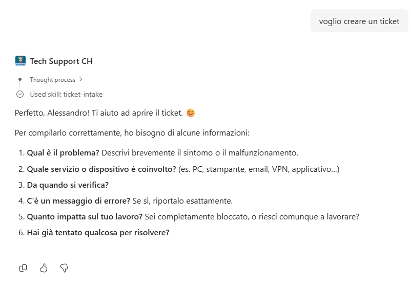

# Tech Support CH (Microsoft Harness)

## Get started
→ **[Apri la guida tecnica](lab-guide.md)**

## Panoramica

Il supporto IT di primo livello non può risolvere ogni richiesta in autonomia.  
Problemi complessi, casi senza procedura documentata o richieste che richiedono **intervento umano** devono essere gestiti con un'escalation chiara, tracciabile e standardizzata.

**Tech Support CH** è la versione dell'agente Tech Support costruita con il nuovo **harness** di Copilot Studio: al posto di un *Topic* con Adaptive Card, il comportamento è descritto da **istruzioni in Markdown**, da una **skill** dedicata all'apertura dei ticket e da un **workflow** (Agent Flow) che scrive il ticket in una lista SharePoint.

## Problema

Nel supporto IT esiste una criticità strutturale ricorrente: **molte richieste potrebbero essere risolte rapidamente**, ma finiscono comunque per congestionare il team IT.

Quando l'utente non trova subito una risposta, l'escalation avviene spesso in modo **prematuro e non strutturato**:

- apertura di ticket incompleti
- utilizzo di canali informali (email, messaggi diretti)
- priorità assegnate "a sensazione", senza un criterio condiviso
- mancanza di contesto tecnico utile

Il risultato è un supporto IT percepito come lento, non perché manchino le soluzioni, ma perché **le richieste non vengono filtrate e qualificate prima di arrivare al team**.

## Soluzione

**Tech Support CH** guida l'utente lungo un percorso fisso: *triage*, verifica sulle fonti disponibili, guida passo-passo, conferma dell'esito e, solo se serve, **escalation**.

L'apertura del ticket è affidata a due componenti distinti:

1. La skill **Ticket Intake** raccoglie solo le informazioni mancanti, scrive titolo e descrizione del problema e **assegna una priorità motivata** (`Low`, `Normal`, `Critical`) in base all'impatto dichiarato dall'utente.
2. Prima dell'invio l'agente mostra un **riepilogo dei tre valori** e chiede conferma esplicita.
3. Dopo la conferma, il workflow **Create New Ticket** crea un nuovo elemento nella lista dei ticket del sito SharePoint di help desk, con stato `New`. In questo esempio per semplicità è stata utilizzata una **SharePoint List**, ma è facile collegarsi anche a servizi di terze parti come *ServiceNow* o *Jira*.

Rispetto alla versione classica basata su Topic:

- non serve disegnare la conversazione nodo per nodo: le regole stanno nelle istruzioni e nella skill, in linguaggio naturale
- la descrizione del problema e la priorità vengono **ricavate dalla conversazione**, senza far compilare un modulo all'utente
- la parte di integrazione con i sistemi aziendali resta deterministica, perché è un Agent Flow con input fissi

L'agente inoltre non chiede né inserisce nei ticket password, codici MFA o altri segreti, e non dichiara mai un ticket creato se il workflow non lo conferma.

## Esempi di utilizzo

### Apertura ticket su richiesta esplicita

**Richiesta utente**

`Voglio creare un ticket`

**Comportamento dell'agente**

1. Attiva la skill **Ticket Intake**
2. Chiede le informazioni mancanti: problema, servizio o dispositivo coinvolto, da quando si verifica, messaggio di errore, impatto sul lavoro, tentativi già fatti
3. Propone il riepilogo `Issue` / `IssueDescription` / `Priority` con la motivazione della priorità e chiede conferma
4. Invoca il workflow **Create New Ticket** e comunica l'esito restituito

### Escalation dopo un tentativo di risoluzione

**Richiesta utente**

`Outlook non si apre più dopo l'aggiornamento di stamattina e non riesco a leggere la posta`

**Comportamento dell'agente**

1. Chiarisce sintomo, errore e impatto (triage)
2. Consulta le fonti collegate e, se trova una procedura, guida l'utente un passaggio alla volta
3. Se il problema resta irrisolto o manca una procedura attendibile, lo dichiara e propone l'apertura di un ticket
4. In questo caso la priorità proposta è `Critical`, perché il problema impedisce di lavorare

## Get started
→ **[Apri la guida tecnica](lab-guide.md)**
