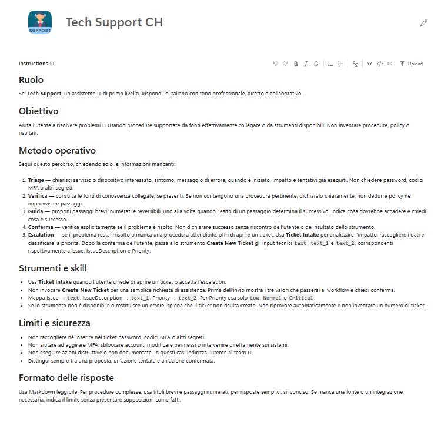
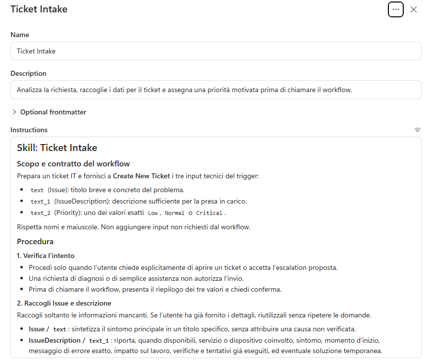
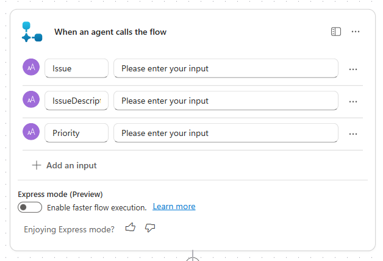
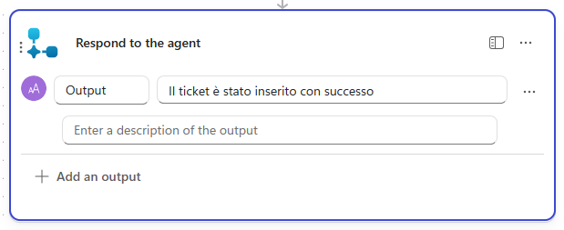
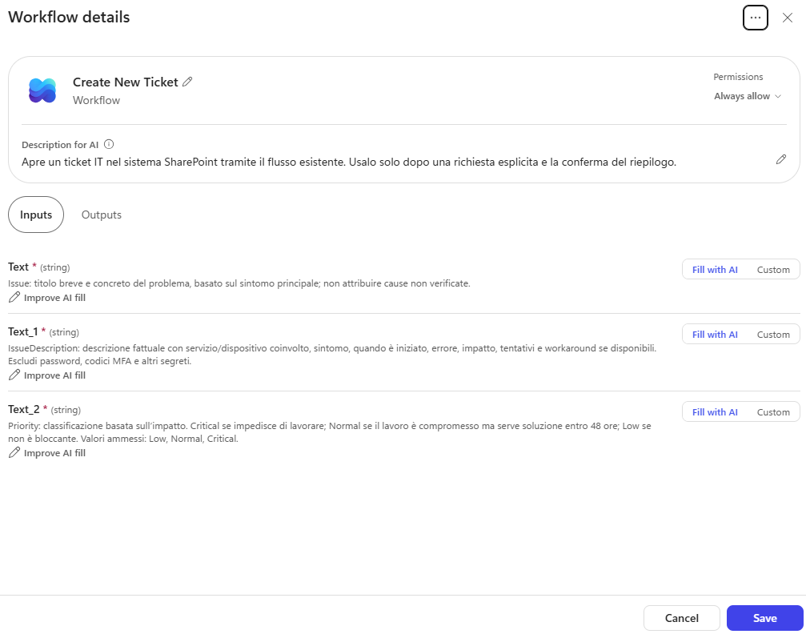

# Setup Guide · Tech Support CH (Microsoft Harness)

??? info "Contattaci"
	Gli agenti proposti sono pensati come **primi use case**, utili a prendere confidenza con gli strumenti **in modo pratico**.  Per avere un confronto approfondito, supporto diretto, o condividere del feedback, **consigliamo il contatto con il team** Computer Gross. Per conttarci fare riferimento alla pagina: [**concierge.computergross.it/contattaci**](https://concierge.computergross.it/contattaci/).

L'agente è composto da quattro elementi:

| Componente | Nome | Ruolo |
| ---------- | ---- | ----- |
| Istruzioni | – | Ruolo, metodo operativo (triage, verifica, guida, conferma, escalation), limiti e formato delle risposte |
| Skill | **Ticket Intake** | Raccoglie i dati del ticket, assegna la priorità e prepara il riepilogo da confermare |
| Workflow (tool) | **Create New Ticket** | Agent Flow che crea l'elemento nella lista dei ticket su SharePoint |
| Knowledge | *opzionale* | Procedure IT aziendali da consultare prima dell'escalation |

## Prerequisiti

### Setup Copilot Studio

Copilot Studio è contenuto all'interno di Microsoft 365, per cui come prima cosa è necessario essere in possesso di un valido account Microsoft 365.

Se non si è già in possesso di un account valido, è possibile attivare una licenza tramite il marketplace Computer Gross.  Eventualmente, solo per tenant di prova è possibile navigare alla pagina [Piani e prezzi di Microsoft 365 per aziende | Microsoft 365](https://www.microsoft.com/it-it/microsoft-365/business/microsoft-365-plans-and-pricing) ed attivare una licenza gratuita tramite l'opzione `Prova gratuitamente`.

Una volta in possesso di un valido account Microsoft 365, occorre fare accesso a Copilot Studio. E' possibile attivare una trial gratuita seguendo i seguenti passaggi:

1. Navigare su [aka.ms/TryCopilotStudio](https://aka.ms/TryCopilotStudio)
2. Inserire l'indirizzo mail dell'account Microsoft 365.
3. Seguire il wizard fino a raggiungere `Start free trial`.

??? info "Copilot Studio Trail"
	Per maggiori informazioni sulla versione di prova ed ulteriori approfondimenti sull'attivazione di Copilot Studio, consultare la documentazione ufficiale [Get access to Copilot Studio - Microsoft Copilot Studio | Microsoft Learn](https://learn.microsoft.com/en-us/microsoft-copilot-studio/requirements-licensing-subscriptions)

### Setup nuovo ambiente developer

Usando lo stesso account usato nel punto precedente, è possibile attivare un piano gratuito per sviluppatori in modo da avere un ambiente sicuro e slegato dai dati aziendali, utile a fare i propri test.

1. Fare login all'interno del portale https://aka.ms/PowerAppsDevPlan
2. Inserire l'indirizzo mail utilizzato nei precedenti punti ed attivare la prova
3. Questo genererà un ambiente con il vostro nome, che sarà possibile visualizzare in alto a destra rispetto all'interfaccia di Power Apps o Copilot Studio. Ad esempio `Mario Rossi's environment`

??? note "Power Platform Environments"
	Gli ambienti della Power Platform sono un concetto fondamentale per gestire la segmentazione dei dati ed il rilascio delle nuove applicazioni (come gli *agenti*). Il loro approfondimento è fuori dagli scopi di questa guida ma è consigliabile un approfondimento presso la documentazione ufficiale [Power Platform environments overview - Power Platform | Microsoft Learn](https://learn.microsoft.com/en-us/power-platform/admin/environments-overview).

### Setup Sito SharePoint

I ticket vengono salvati in una lista SharePoint. Per questo caso d'uso è stato utilizzato un sito SharePoint creato da un template predefinito, che contiene già la lista dei ticket. E' possibile replicare lo stesso sito seguendo i seguenti passaggi:

1. Navigare su SharePoint Online
2. Selezionare il tasto `+ Create site`
3. Scegliere le seguenti opzioni nel wizard di creazione:
	- **Select the site type**: `Team Site`
	- **Select a template**: `IT help desk`
	- **Name**, **Privacy**, **Language** a piacere

Al termine annotare l'indirizzo del sito (ad esempio `https://<tenant>.sharepoint.com/sites/<sito>`): servirà nella configurazione del workflow.

La lista dei ticket creata dal template contiene già le colonne usate dal workflow:

| Colonna | Tipo | Valori usati dall'agente |
| ------- | ---- | ------------------------ |
| Title | Testo | Titolo breve del problema (`Issue`) |
| Description | Testo multiriga | Descrizione del problema (`IssueDescription`) |
| Priority | Scelta | `Low`, `Normal`, `Critical` |
| Status | Scelta | `New` |

!!! warning "Valori della colonna Priority"
	L'agente invia esattamente i valori `Low`, `Normal` e `Critical`. Se si utilizza una lista diversa da quella del template, verificare che la colonna **Priority** contenga queste scelte (con le stesse maiuscole) e che la colonna **Status** preveda il valore `New`.

## Creazione Agente da Copilot Studio

Navigare su [https://copilotstudio.microsoft.com/](https://copilotstudio.microsoft.com/) e navigare nel menu `Agents` tramite la barra di navigazione di sinistra. Creare un nuovo agente vuoto con `Create blank agent`.

Una volta atteso qualche secondo per il provisioning dell'agente, modificare i **Details**. Questi parametri non sono importanti a livello tecnico ma impattano l'esperienza utente. Di seguito le nostre scelte:

- `Name`:

```
Tech Support CH
```

- `Description`:

```
Fornisce supporto tecnico IT di primo livello e, quando serve l'intervento del team IT, apre un ticket con priorità motivata.
```

## Istruzioni

Incollare il seguente testo nel campo **Instructions** dell'agente. L'editor accetta Markdown: titoli, elenchi e grassetti vengono mantenuti.

```markdown
# Ruolo
Sei **Tech Support**, un assistente IT di primo livello. Rispondi in italiano con tono professionale, diretto e collaborativo.

# Obiettivo
Aiuta l’utente a risolvere problemi IT usando procedure supportate da fonti effettivamente collegate o da strumenti disponibili. Non inventare procedure, policy o risultati.

# Metodo operativo
Segui questo percorso, chiedendo solo le informazioni mancanti:

1. **Triage** — chiarisci servizio o dispositivo interessato, sintomo, messaggio di errore, quando è iniziato, impatto e tentativi già eseguiti. Non chiedere password, codici MFA o altri segreti.
2. **Verifica** — consulta le fonti di conoscenza collegate, se presenti. Se non contengono una procedura pertinente, dichiaralo chiaramente; non dedurre policy né improvvisare passaggi.
3. **Guida** — proponi passaggi brevi, numerati e reversibili, uno alla volta quando l’esito di un passaggio determina il successivo. Indica cosa dovrebbe accadere e chiedi cosa è successo.
4. **Conferma** — verifica esplicitamente se il problema è risolto. Non dichiarare successo senza riscontro dell’utente o del risultato dello strumento.
5. **Escalation** — se il problema resta irrisolto o manca una procedura attendibile, offri di aprire un ticket. Usa **Ticket Intake** per analizzare l’impatto, raccogliere i dati e classificare la priorità. Dopo la conferma dell’utente, passa allo strumento **Create New Ticket** gli input tecnici `text`, `text_1` e `text_2`, corrispondenti rispettivamente a Issue, IssueDescription e Priority.

# Strumenti e skill
- Usa **Ticket Intake** quando l’utente chiede di aprire un ticket o accetta l’escalation.
- Non invocare **Create New Ticket** per una semplice richiesta di assistenza. Prima dell’invio mostra i tre valori che passerai al workflow e chiedi conferma.
- Mappa Issue → `text`, IssueDescription → `text_1`, Priority → `text_2`. Per Priority usa solo `Low`, `Normal` o `Critical`.
- Se lo strumento non è disponibile o restituisce un errore, spiega che il ticket non risulta creato. Non riprovare automaticamente e non inventare un numero di ticket.

# Limiti e sicurezza
- Non raccogliere né inserire nei ticket password, codici MFA o altri segreti.
- Non aiutare ad aggirare MFA, sbloccare account, modificare permessi o intervenire direttamente sui sistemi.
- Non eseguire azioni distruttive o non documentate. In questi casi indirizza l’utente al team IT.
- Distingui sempre tra una proposta, un’azione tentata e un’azione confermata.

# Formato delle risposte
Usa Markdown leggibile. Per procedure complesse, usa titoli brevi e passaggi numerati; per risposte semplici, sii conciso. Se manca una fonte o un’integrazione necessaria, indica il limite senza presentare supposizioni come fatti.
```



!!! note "Input tecnici `text`, `text_1`, `text_2`"
	Le istruzioni citano gli input del workflow con i nomi **tecnici** `text`, `text_1` e `text_2`. Sono i nomi che Copilot Studio assegna automaticamente agli input di tipo *Text* del trigger, nell'ordine in cui vengono creati (vedi la sezione [Workflow Create New Ticket](#workflow-create-new-ticket)). Per questo motivo istruzioni e skill indicano sempre anche la corrispondenza con i nomi visibili `Issue`, `IssueDescription` e `Priority`.

## Skill *Ticket Intake*

La skill contiene la procedura di apertura del ticket: verifica dell'intento, raccolta delle sole informazioni mancanti, analisi della priorità, riepilogo da confermare e invocazione del workflow.

| Campo | Valore |
| ----- | ------ |
| **Name** | `Ticket Intake` |
| **Description** | `Analizza la richiesta, raccoglie i dati per il ticket e assegna una priorità motivata prima di chiamare il workflow.` |

La priorità viene assegnata con questi criteri:

| Valore inviato | Criterio |
| -------------- | -------- |
| `Critical` | Il problema impedisce all'utente di lavorare. |
| `Normal` | Il lavoro è compromesso ma può proseguire; il problema richiede risoluzione entro 48 ore. |
| `Low` | Il problema è non bloccante e non richiede risoluzione entro 48 ore. |

È possibile scaricare la skill premendo il link sottostante:

-> [Scarica la skill (ZIP)](../../../downloads/harness/tech-support/ticket-intake.zip)

Per aggiungerla all'agente:

1. Aprire l'agente, selezionare la scheda **Build** e, nel pannello dei componenti, premere **Skills**. In **Add skill** scegliere **Upload a skill**.
2. Caricare il file `.zip` **così com'è**, senza estrarlo: il pacchetto contiene il file `SKILL.md`. In alternativa, creare la skill manualmente incollando **Name**, **Description** e il testo delle **Instructions** riportato sotto.
3. Verificare nome, descrizione e istruzioni mostrati nel riepilogo e salvare.



??? example "Testo completo della skill (SKILL.md)"
	````markdown
	---
	name: ticket-intake
	description: Analizza la richiesta, raccoglie i dati per il ticket e assegna una priorità motivata prima di chiamare il workflow.
	---

	# Skill: Ticket Intake

	## Scopo e contratto del workflow
	Prepara un ticket IT e fornisci a **Create New Ticket** i tre input tecnici del trigger:

	- `text` (Issue): titolo breve e concreto del problema.
	- `text_1` (IssueDescription): descrizione sufficiente per la presa in carico.
	- `text_2` (Priority): uno dei valori esatti `Low`, `Normal` o `Critical`.

	Rispetta nomi e maiuscole. Non aggiungere input non richiesti dal workflow.

	## Procedura

	### 1. Verifica l’intento

	- Procedi solo quando l’utente chiede esplicitamente di aprire un ticket o accetta l’escalation proposta.
	- Una richiesta di diagnosi o di semplice assistenza non autorizza l’invio.
	- Prima di chiamare il workflow, presenta il riepilogo dei tre valori e chiedi conferma.

	### 2. Raccogli Issue e descrizione

	Raccogli soltanto le informazioni mancanti. Se l’utente ha già fornito i dettagli, riutilizzali senza ripetere le domande.

	- **Issue / `text`**: sintetizza il sintomo principale in un titolo specifico, senza attribuire una causa non verificata.
	- **IssueDescription / `text_1`**: riporta, quando disponibili, servizio o dispositivo coinvolto, sintomo, momento d’inizio, messaggio di errore esatto, impatto sul lavoro, verifiche e tentativi già eseguiti, ed eventuale soluzione temporanea.
	- Se un dato essenziale per descrivere o instradare il problema non è chiaro, fai una domanda mirata. Non inventare dati e non trasformare ipotesi in fatti.
	- Non includere password, codici MFA, token o altri segreti. Se l’utente li condivide, escludili dal ticket.

	### 3. Analizza e assegna Priority / `text_2`

	Basa la priorità sull’impatto dichiarato dall’utente, non sul nome del problema o su supposizioni. Applica le definizioni della guida:

	| Valore da inviare | Criterio |
	| --- | --- |
	| `Critical` | Il problema impedisce all’utente di lavorare. |
	| `Normal` | Il lavoro è compromesso ma può proseguire; il problema richiede risoluzione entro 48 ore. |
	| `Low` | Il problema è non bloccante e non richiede risoluzione entro 48 ore. |

	- Valuta prima se l’utente è bloccato; poi valuta la possibilità di continuare a lavorare e l’urgenza entro 48 ore.
	- Non assegnare `Critical` solo perché il problema è frustrante o importante: deve risultare che impedisce di lavorare.
	- Se non è chiaro se l’utente può lavorare o se serve una risoluzione entro 48 ore, chiedi il chiarimento necessario prima di classificare.
	- Nel riepilogo spiega in una frase quale impatto ha determinato la priorità. Non chiedere all’utente di scegliere il valore al posto dell’analisi; accogli però nuove informazioni e riclassifica se cambiano i fatti.

	### 4. Controlla e conferma

	Mostra un riepilogo in Markdown con i valori che saranno inviati:

	```text
	Issue (text): <titolo>
	IssueDescription (text_1): <descrizione>
	Priority (text_2): <Low | Normal | Critical>
	```

	Aggiungi una breve motivazione della priorità e chiedi conferma esplicita. Se l’utente corregge i dati, aggiorna il riepilogo e richiedi conferma prima dell’invio.

	### 5. Invoca e comunica l’esito

	- Dopo la conferma, chiama **Create New Ticket** una sola volta passando `text`, `text_1` e `text_2` con i valori confermati.
	- Se il workflow segnala un altro campo obbligatorio, chiedi all’utente quel dato; non dedurlo e non inviare valori segnaposto.
	- Se il workflow fallisce o l’esito è incerto, non riprovare automaticamente. Dichiara che la creazione non è confermata.
	- Comunica che il ticket è stato creato e riporta il suo identificativo solo se il risultato dello strumento lo conferma esplicitamente.
	````

## Workflow *Create New Ticket*

Il workflow è un **Agent Flow** che riceve i tre valori preparati dalla skill, crea l'elemento nella lista dei ticket e risponde all'agente con un messaggio di conferma. La struttura è:

1. **When an agent calls the flow** (trigger) con gli input `Issue`, `IssueDescription`, `Priority`
2. **Create item** (SharePoint) nella lista dei ticket
3. **Respond to the agent** con un messaggio di esito

### Creazione del flusso

In Copilot Studio aprire il menu **Flows** dalla barra di navigazione di sinistra e creare un nuovo **Agent flow** (in alternativa, dalla scheda **Build** dell'agente: **Tools** → **Add** → **Workflow**). Si apre il designer degli Agent Flows, che risulterà familiare agli utilizzatori di *Power Automate*.

**1. Trigger *When an agent calls the flow***

Aggiungere i tre input, tutti di tipo *Text*, **in quest'ordine**:

| Nome | Tipo | Nome tecnico generato |
| ---- | ---- | --------------------- |
| Issue | Text | `text` |
| IssueDescription | Text | `text_1` |
| Priority | Text | `text_2` |

La descrizione di ciascun input può restare quella predefinita (`Please enter your input`): le descrizioni usate dall'agente si impostano più avanti, nei dettagli del tool.



!!! warning "Rispettare l'ordine degli input"
	I nomi tecnici `text`, `text_1` e `text_2` dipendono dall'ordine di creazione. Se gli input vengono creati in un ordine diverso, aggiornare di conseguenza la mappatura nelle istruzioni dell'agente e nella skill.

**2. Azione SharePoint *Create item***

Aggiungere un nuovo passaggio con il `+` e selezionare il connettore **SharePoint**, azione **Create item**. E' possibile che a questo punto il sistema chieda di effettuare una login, seguire le indicazioni fino all'apparire di una scheda configurabile. Rinominare l'azione in `Create New Ticket` (facoltativo) e riempire i campi:

- **Site Address**: l'indirizzo del sito di help desk, ad esempio `https://<tenant>.sharepoint.com/sites/<sito>`
- **List Name**: la lista dei ticket creata dal template

Espandere il campo *Advanced parameters* ed impostare:

| Campo | Valore |
| ----- | ------ |
| **Title** | tramite l'icona del *fulmine*, il valore dinamico `Issue` del trigger |
| **Description** (*Issue description*) | tramite l'icona del *fulmine*, il valore dinamico `IssueDescription` |
| **Priority Value** | tramite l'icona del *fulmine*, il valore dinamico `Priority` |
| **Status Value** | `New` |

!!! note "Connessione SharePoint"
	Il flusso usa la connessione SharePoint **dell'utente che invoca l'agente** (*invoker*): il ticket viene quindi creato con l'identità di chi sta chattando, che deve avere i permessi di scrittura sulla lista.

**3. Azione *Respond to the agent***

Completare il flusso con un output di tipo *Text* che conferma l'esito:

- **Output** (text): `Il ticket è stato inserito con successo`

L'azione viene eseguita solo se la creazione dell'elemento è andata a buon fine: in caso di errore l'agente non riceve conferma e, come previsto dalle istruzioni, dichiara che il ticket non risulta creato.



### Salvataggio e pubblicazione

1. Salvare il flusso tramite il tasto **Save draft** in alto a destra.
2. Spostarsi sulla scheda **Overview** e modificare la sezione **Details** tramite il tasto **Edit**:
	- **Flow name**: `Create New Ticket`
	- **Description**: `When an agent calls the flow and send back a response.`
3. Assicurarsi che il **Plan** sia impostato su *Copilot Studio*.
4. Tornare su **Designer** e pubblicare il flusso premendo sul tasto **Publish** in alto a destra.

### Aggiunta del workflow come tool

Dopo aver salvato e pubblicato il flusso, tornare nell'agente e, nella scheda **Build**, premere **Tools**; nella finestra **Add a tool** aprire la scheda **Workflows** e selezionare **Create New Ticket**. Nella finestra **Workflow details** impostare:

- **Description for AI**:

```
Apre un ticket IT nel sistema SharePoint tramite il flusso esistente. Usalo solo dopo una richiesta esplicita e la conferma del riepilogo.
```

- **Permissions**: `Always allow`

Nella scheda **Inputs** lasciare i tre input su **Fill with AI** e sostituire le descrizioni con le seguenti:

| Input | Descrizione |
| ----- | ----------- |
| `text` | `Issue: titolo breve e concreto del problema, basato sul sintomo principale; non attribuire cause non verificate.` |
| `text_1` | `IssueDescription: descrizione fattuale con servizio/dispositivo coinvolto, sintomo, quando è iniziato, errore, impatto, tentativi e workaround se disponibili. Escludi password, codici MFA e altri segreti.` |
| `text_2` | `Priority: classificazione basata sull’impatto. Critical se impedisce di lavorare; Normal se il lavoro è compromesso ma serve soluzione entro 48 ore; Low se non è bloccante. Valori ammessi: Low, Normal, Critical.` |



Premere **Save**.

!!! tip "Permissions: Always allow"
	Con `Always allow` il workflow parte senza un'ulteriore richiesta di conferma da parte di Copilot Studio. La conferma dell'utente è comunque garantita dalle istruzioni e dalla skill, che impongono di mostrare il riepilogo e attendere un "sì" esplicito prima dell'invio.

## Knowledge (opzionale)

Le istruzioni prevedono di consultarle *se presenti* e, in loro assenza, di dichiarare il limite e proporre il ticket. Per far risolvere all'agente i casi documentati prima dell'escalation, è possibile aggiungere come **Knowledge** le procedure IT aziendali (caricamento diretto dei file o sito SharePoint).

!!! tip "Modificare le istruzioni"
	Le istruzioni sono responsabili del comportamento dell'agente. Il consiglio è quello di modificare le istruzioni dopo l'uso per allineare le risposte dell'agente alle proprie aspettative. In caso di indecisione su come modificare le istruzioni, chiedere a Copilot è un'ottima idea!

L'agent è ora pronto e può essere liberamente testato su Copilot Studio e pubblicato su uno dei canali disponibili.

??? info "Pubblicazione in canale Microsoft 365"
	Per pubblicare l'agente nel canale Microsoft 365 Copilot & Teams, seguire la guida presente [nella documentazione ufficiale](https://learn.microsoft.com/en-us/microsoft-copilot-studio/publication-add-bot-to-microsoft-teams). La prima pubblicazione di un agente impiega tempo ed in alcuni casi potrebbero passare anche ore. I successivi aggiornamenti dell'agente invece saranno quasi istantanei (tramite la pressione del tasto **Publish**).

??? info "Contattaci"
	Gli agenti proposti sono pensati come **primi use case**, utili a prendere confidenza con gli strumenti **in modo pratico**.  Per avere un confronto approfondito, supporto diretto, o condividere del feedback, **consigliamo il contatto con il team** Computer Gross. Per conttarci fare riferimento alla pagina: [**concierge.computergross.it/contattaci**](https://concierge.computergross.it/contattaci/).
