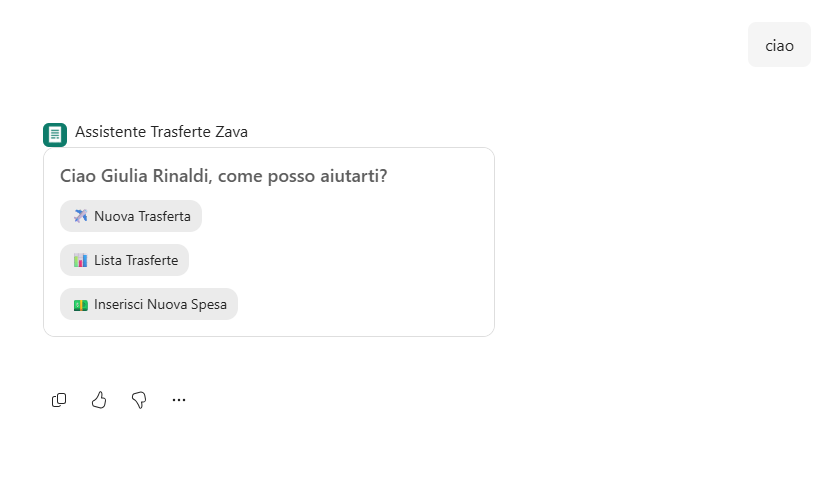
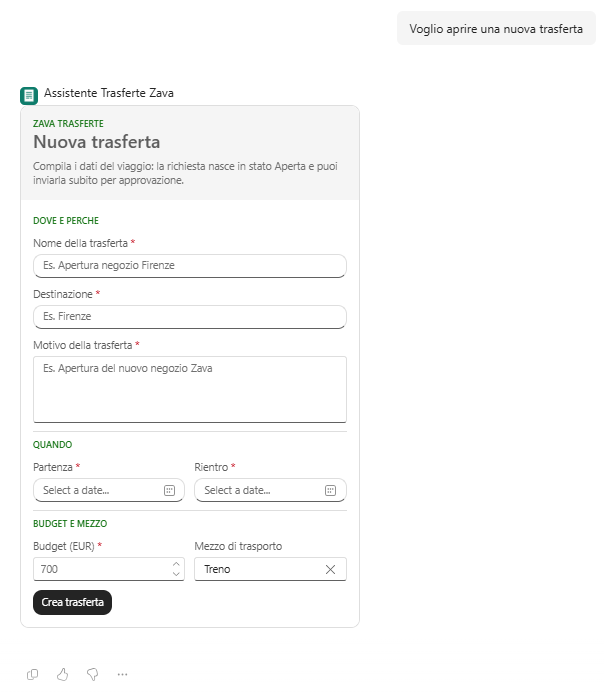
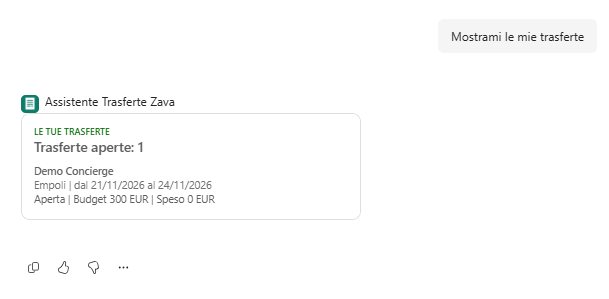
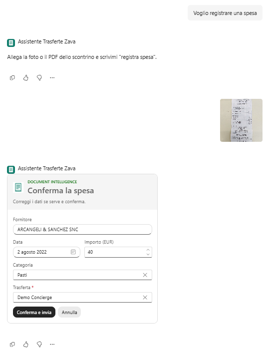
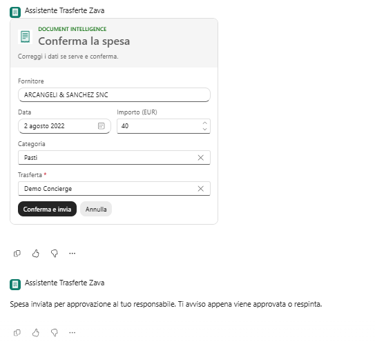

# Assistente Trasferte Zava · v2 (Copilot Studio)

## Per iniziare
→ **[Apri la guida tecnica](lab-guide.md)**

## Panoramica

Per un'azienda con molti dipendenti in viaggio, la **gestione di trasferte e note spese** è un'attività frequente e ripetitiva: aprire la richiesta di trasferta, conservare gli scontrini, ricopiarne i dati e inviarli all'amministrazione.

Queste attività:

- Coinvolgono documenti cartacei facili da perdere o rovinare
- Richiedono di ricopiare a mano fornitore, data e importo di ogni scontrino
- Generano errori di battitura e ritardi nei rimborsi

Con **Assistente Trasferte Zava** l'obiettivo è portare l'intero processo dentro una conversazione: il dipendente apre la trasferta da una scheda in chat, fotografa lo scontrino e l'agente ne estrae i dati grazie ad **Azure AI Document Intelligence**, uno dei *Foundry Tools* di **Microsoft Foundry**.

## Problema

Abbiamo identificato tre criticità principali nella gestione manuale delle note spese:

- **Ricopiatura manuale**: i dati dello scontrino vengono trascritti a mano in fogli Excel o email, con errori e perdite di tempo.
- **Dati non strutturati**: trasferte e spese vivono in file e caselle di posta diverse, senza un'unica base dati.
- **Nessuna tracciabilità**: non è chiaro da dove arrivi un dato, quanto sia affidabile e a quale trasferta appartenga una spesa.

## Soluzione

**Assistente Trasferte Zava** è un agente Copilot Studio con **orchestrazione generativa**: le *Istruzioni* indirizzano ogni richiesta verso uno dei tre *Topic* dedicati, che guidano la conversazione in modo controllato.

L'agente:

- Apre una nuova trasferta tramite *Adaptive Card*, scrivendo direttamente in **Dataverse** con le credenziali dell'utente
- Elenca le trasferte aperte dell'utente leggendo i dati da Dataverse
- Registra una spesa a partire dalla foto o dal PDF dello scontrino: un *Agent Flow* invia il file ad **Azure AI Document Intelligence** (modello `prebuilt-receipt`) e restituisce fornitore, data, importo e confidenza
- Mostra all'utente una scheda precompilata e modificabile, e salva la spesa solo dopo la conferma
- Conserva nella spesa il JSON di Document Intelligence, la confidenza e il file dello scontrino

Questo approccio permette di:

- Eliminare la ricopiatura: l'utente controlla i dati, non li scrive
- Mantenere trasferte, spese e categorie in tabelle Dataverse strutturate
- Tracciare l'origine di ogni dato (JSON dell'analisi, confidenza, file originale)
- Separare la conversazione (Copilot Studio) dalla lettura dei documenti (Foundry Tools)

!!! note "Ambito della guida"
    Questa guida tratta l'**agente** (dettagli, modello, istruzioni), i **Topic**, i **Tool**, gli **Agent Flow** chiamati dall'agente. I flussi "sotto al cofano" (approvazioni e notifiche in Teams) non sono trattati.

## Esempio di utilizzo

### Aprire una nuova trasferta

**Richiesta utente**

`Voglio aprire una nuova trasferta`

**Comportamento dell'agente**

- L'orchestratore sceglie il topic *Apertura Trasferta*
- Mostra la scheda con nome, destinazione, motivo, date, budget e mezzo di trasporto
- Crea la riga nella tabella *Trasferta* in stato *Aperta* e conferma in chat

### Consultare le proprie trasferte

**Richiesta utente**

`Mostrami le mie trasferte`

**Comportamento dell'agente**

- L'orchestratore sceglie il topic *Lista Trasferte*
- Legge da Dataverse le trasferte dell'utente in stato *Aperta*, *Inviata per approvazione* o *Approvata*
- Restituisce una scheda con destinazione, date, stato, budget e totale speso

### Registrare una spesa dallo scontrino

**Richiesta utente**

`Voglio registrare una spesa` + foto dello scontrino

**Comportamento dell'agente**

- L'orchestratore sceglie il topic *Registra spesa*, che controlla allegato e trasferte aperte
- L'Agent Flow *Estrai dati ricevuta* analizza lo scontrino con Document Intelligence
- L'agente mostra la scheda *Conferma la spesa* con i dati precompilati, la categoria proposta e la trasferta da scegliere
- Alla conferma, l'Agent Flow *Inserimento spesa* salva la spesa e il file dello scontrino in Dataverse

## Per iniziare
→ **[Apri la guida tecnica](lab-guide.md)**
